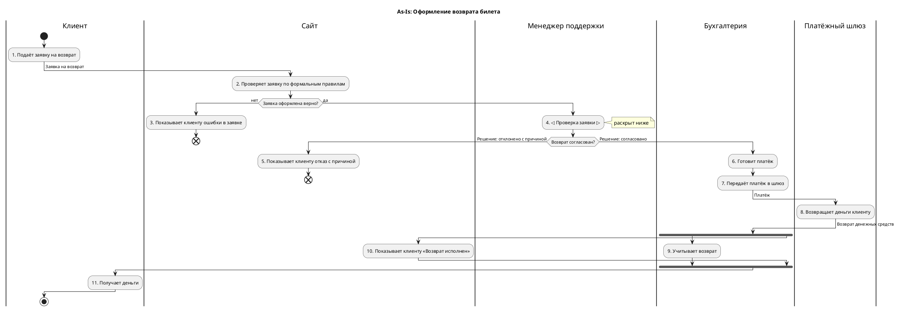
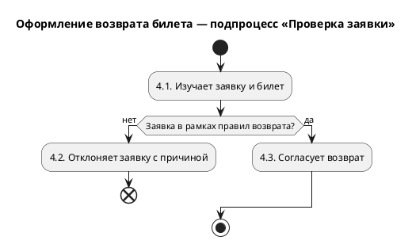

# Оформление возврата билета — бизнес-процесс (BPMN)

> Образец языка скилла `business-process-analyst`: показывает, как выглядит бизнес-слой без техники (разделы 1–8) и техническая привязка (раздел 9). **Данные условные**: процесс, участники, документы и точки входа — иллюстративные. Структура документа — по эталону `ideal_bpmn_process.md`; диаграмма — проверенная рендером (`bpmn_example_ticket_refund.puml`). Задача: [T12].

**Процесс**: Оформление возврата билета · **Владелец процесса**: руководитель службы поддержки · **Режим**: As-Is · **Участники**: Клиент, Сайт, Менеджер поддержки, Бухгалтерия, Платёжный шлюз · **Триггер**: клиент подаёт заявку на возврат · **Вход → Выход**: билет → возвращённые денежные средства | отказ с причиной

**Аудитория**: бизнес-заказчик и бизнес-аналитик (разделы 1–8); системный аналитик (раздел 9). **Язык**: разделы 1–8 — бизнес-язык, без технических деталей; раздел 9 — техническая привязка. **Цветовое измерение**: нет.

## 1. Общее описание

Процесс начинается, когда клиент подаёт заявку на возврат билета, и заканчивается, когда клиент получает деньги или мотивированный отказ. Назначение процесса — вернуть клиенту стоимость билета в соответствии с правилами возврата и корректно отразить возврат в учёте. Решение о возврате принимает Менеджер поддержки; денежные средства возвращает Бухгалтерия через Платёжный шлюз; Сайт принимает заявку и показывает клиенту результат на каждом этапе.

## 2. Участники и роли

| Участник | Тип | Зона ответственности | Получает / отдаёт |
|---|---|---|---|
| Клиент | человек | инициирует возврат, предоставляет данные для перечисления денег | билет / заявку на возврат; получает деньги или отказ |
| Сайт | система | принимает заявку, проверяет её по формальным правилам, показывает результат | заявку / статус возврата |
| Менеджер поддержки | человек | проверяет заявку по правилам возврата, принимает решение | заявку на проверке / решение: согласовано или отклонено |
| Бухгалтерия | человек | готовит платёж и учитывает возврат | решение «согласовано» / платёж, запись в учёте |
| Платёжный шлюз | система | возвращает денежные средства клиенту | платёж / подтверждение возврата |

## 3. Объекты и состояния

| Бизнес-объект | Что это | Состояния | Кто меняет состояние |
|---|---|---|---|
| Заявка на возврат | обращение клиента о возврате стоимости билета | новая → на проверке → согласована → исполнена; отклонена | Сайт, Менеджер поддержки, Бухгалтерия |
| Билет | право клиента на посещение мероприятия | действует → возвращён (при отказе остаётся действующим) | Бухгалтерия |

## 4. Бизнес-правила

| № | Правило | Где применяется | Источник |
|---|---|---|---|
| П1 | Заявку можно подать не позднее чем за 24 часа до начала мероприятия | шаг 2, ветка В1 | [УТОЧНИТЬ: срок — подтвердить у руководителя службы поддержки] |
| П2 | Возврат возможен, только если билет не был использован на входе | шаг 4 (П.«Проверка заявки»), ветка В2 | постановка задачи [T12] |
| П3 | Решение по заявке Менеджер поддержки принимает в течение одного рабочего дня | шаг 4 (П.«Проверка заявки») | [УТОЧНИТЬ: срок — подтвердить у руководителя службы поддержки] |

## 5. Диаграмма

> BPMN-профиль PlantUML. Первый блок — основной сценарий (шаги 1–11; шаг 4 — свёрнутый подпроцесс), второй — раскрытие подпроцесса «Проверка заявки». Те же блоки — в `bpmn_example_ticket_refund.puml`.

## 6. Пошаговое описание

| № | Шаг | Участник | Вход → результат | Правило |
|---|---|---|---|---|
| 1 | Подаёт заявку на возврат | Клиент | билет → заявка на возврат | — |
| 2 | Проверяет заявку по формальным правилам | Сайт | заявка → заявка принята или список ошибок | П1 |
| 3 | Показывает клиенту ошибки в заявке | Сайт | список ошибок → заявка не создана, процесс завершён | — |
| 4 | ◁ Проверка заявки ▷ | Менеджер поддержки | заявка на проверке → решение: согласовано или отклонено с причиной | П2, П3 |
| 5 | Показывает клиенту отказ с причиной | Сайт | решение «отклонено» → клиент видит причину, процесс завершён | — |
| 6 | Готовит платёж | Бухгалтерия | решение «согласовано» → платёж | — |
| 7 | Передаёт платёж в шлюз | Бухгалтерия | платёж → платёж передан | — |
| 8 | Возвращает деньги клиенту | Платёжный шлюз | платёж → возврат денежных средств | — |
| 9 | Учитывает возврат | Бухгалтерия | подтверждение возврата → запись в учёте | — |
| 10 | Показывает клиенту «Возврат исполнен» | Сайт | подтверждение возврата → статус возврата | — |
| 11 | Получает деньги | Клиент | возврат денежных средств → процесс завершён | — |

## 7. Ветвления, циклы, исключения

| № | Тип | Условие | Ветки | Что происходит |
|---|---|---|---|---|
| В1 | шлюз «или» | Заявка оформлена верно? | нет → шаг 3; да → шаг 4 | Нет — Сайт показывает ошибки, заявка не создаётся, процесс завершён (⊗). Да — заявка уходит на проверку Менеджеру поддержки |
| В2 | шлюз «или» | Возврат согласован? | нет → шаг 5; да → шаги 6–11 | Нет — клиент видит отказ с причиной, билет остаётся действующим, процесс завершён (⊗). Да — Бухгалтерия готовит и передаёт платёж |
| В3 | параллельность | после шага 8 | шаги 9 и 10 одновременно | Бухгалтерия учитывает возврат, Сайт показывает статус; процесс завершается, когда оба шага выполнены |
| П.«Проверка заявки» | подпроцесс | — | 4.1 → 4.2 / 4.3 | Вход: заявка на проверке. 4.1 Менеджер изучает заявку и билет. Если заявка вне правил (П2) — 4.2 отклоняет с причиной (→ В2 «нет»). Иначе — 4.3 согласует возврат (→ В2 «да»). Срок решения — один рабочий день (П3) |

## 8. Показатели и проблемы (As-Is)

- Проверка заявки (шаг 4) — ручной шаг: срок решения зависит от загрузки Менеджеров поддержки. Средний срок — [УТОЧНИТЬ: спросить у руководителя службы поддержки].
- Между шагами 2 и 10 клиент не видит статус заявки — [УТОЧНИТЬ: проверить, показывает ли Сайт статус «на проверке»].
- Заявки, оформленные с ошибками (ветка В1 «нет»), клиент подаёт заново с нуля — повторный ввод всех данных.

## 9. Техническая привязка (для аналитика)

> Условные данные: показывают форму раздела. Ссылки относительные; пробелы — `[NEEDS_INVESTIGATION: что искать]`.

| Участник | Сервис / система | Документ-владелец |
|---|---|---|
| Сайт | `tickets-web` (личный кабинет) | `../screens/screen_refund_form.md` (✅) |
| Менеджер поддержки | `tickets-support` (очередь заявок) | `../screens/screen_refund_queue.md` (🟡 — не валидировано) |
| Бухгалтерия | ручная операция в учётной системе; интеграции нет | — |
| Платёжный шлюз | провайдер платежей (внешний) | `../integrations/integration_payment_gateway.md` (✅) |

| Триггер | Точка входа | Документ |
|---|---|---|
| Клиент подаёт заявку | `POST /api/v1/orders/{id}/refund` | `../api/api_create_refund.md` (✅) |

| Бизнес-объект | Данные | Документ |
|---|---|---|
| Заявка на возврат | `tickets_db.tickets.refund_request` (статусы: `new`, `review`, `approved`, `done`, `rejected`) | `../erd/erd_refund.md` (✅) |
| Билет | `tickets_db.tickets.ticket` (`returned_at`) | `../data_trace_ticket.md` (✅) |

| Шаг | Как реализован | Документ |
|---|---|---|
| 2 | `RefundController::create` → `RefundPolicy::validateFormal` | `../processes/process_refund.md` (✅) |
| 4 | решение менеджера: `RefundController::approve` / `RefundController::reject` | `../api/api_approve_refund.md` (✅) |
| 6–9 | `RefundPaymentService::pay` → провайдер платежей; учёт — вручную | `../processes/process_refund.md` (✅) |

## 10. Источники

| Источник | Статус | Что взято |
|---|---|---|
| `../processes/process_refund.md` | ✅ | цепочка шагов, ветвления (подняты на бизнес-уровень: 9 технических шагов → 11 бизнес-шагов с распределением по участникам) |
| `../screens/screen_refund_form.md`, `../screens/screen_refund_queue.md` | ✅ / 🟡 — не валидировано | действия Клиента и Менеджера поддержки |
| `../integrations/integration_payment_gateway.md` | ✅ | участник «Платёжный шлюз», шаг 8 |
| `../erd/erd_refund.md`, `../data_trace_ticket.md` | ✅ | объекты и состояния (раздел 3) |
| `naming_conventions.md` | ✅ | бизнес-имена систем и объектов |
| постановка задачи [T12] | — | правило П2, проблема из раздела 8 (со слов владельца процесса) |
| `repomix-output.xml` | снапшот 2026-11-20 | статусы заявки на возврат (раздел 9) |
