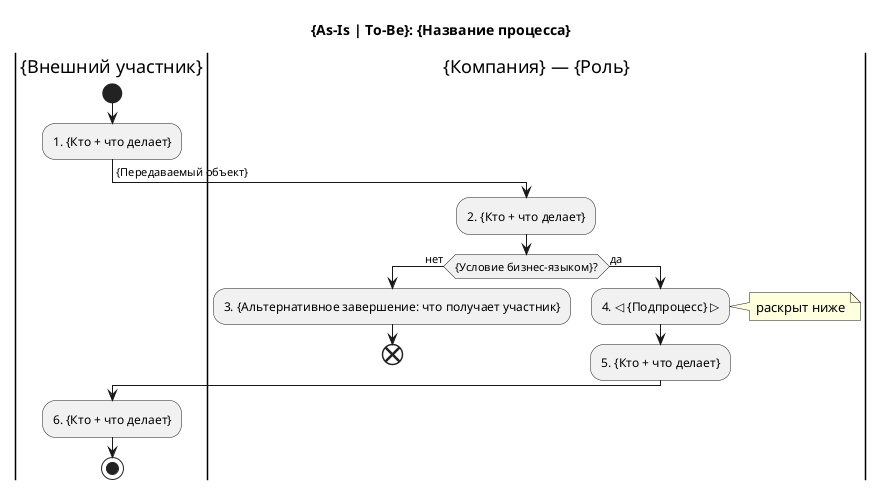

# Шаблон: Бизнес-процесс в нотации BPMN

> **Назначение шаблона.** Документ типа **BPMN** — описание одного бизнес-процесса глазами бизнес-аналитика: участники, шаги, объекты, бизнес-правила, ветвления и исключения — на языке бизнеса, с диаграммой BPMN-профиля (PlantUML) и текстовым описанием. Технические абстракции допускаются только верхнеуровневые (система — чёрный ящик) и только в разделе 9. Он не дублирует `processes/process_*.md` (технический разбор по коду) — на них даются ссылки. Структура обязательна; разделы не удалять. Уровень языка — по образцу `examples/bpmn_example_ticket_refund.md`.

**Процесс**: `{Человекочитаемое название}` · **Владелец процесса**: `{бизнес-роль, отвечающая за результат}` · **Режим**: `{As-Is | To-Be — источник требований: ссылка}` · **Участники**: `{роли и системы через запятую}` · **Триггер**: `{событие}` · **Вход → Выход**: `{объект на входе} → {результат}`

**Аудитория**: бизнес-заказчик и бизнес-аналитик (разделы 1–8); системный аналитик (раздел 9). **Язык**: разделы 1–8 — бизнес-язык, без технических деталей; раздел 9 — техническая привязка. **Цветовое измерение**: `{нет | изменения To-Be | способ выполнения}`.

## 1. Общее описание

`{Зачем процесс существует, с чего начинается и чем заканчивается, какой результат получает бизнес или клиент. 3–7 предложений на бизнес-языке.}`

## 2. Участники и роли

| Участник | Тип | Зона ответственности | Получает / отдаёт |
|---|---|---|---|
| `{Роль или система — бизнес-имя}` | `{человек | система}` | `{за что отвечает в процессе}` | `{что получает} / {что отдаёт}` |

## 3. Объекты и состояния

| Бизнес-объект | Что это | Состояния | Кто меняет состояние |
|---|---|---|---|
| `{Заявка на возврат}` | `{определение бизнес-языком}` | `{новая → на проверке → согласована → исполнена; отклонена}` | `{участники}` |

## 4. Бизнес-правила

| № | Правило | Где применяется | Источник |
|---|---|---|---|
| П1 | `{Формулировка на бизнес-языке: «Возврат возможен не позднее чем за 24 часа до мероприятия»}` | `{шаг 2, ветка В1}` | `{документ | бизнес-артефакт | постановка задачи | [УТОЧНИТЬ: кому задать вопрос]}` |

## 5. Диаграмма

> BPMN-профиль PlantUML — `skills/business-process-analyst/resources/bpmn_plantuml_profile.md`. Первый блок — основной сценарий, далее — раскрытые подпроцессы. Те же блоки — в `bpmn_<название>.puml` рядом с документом.

## 6. Пошаговое описание

| № | Шаг | Участник | Вход → результат | Правило |
|---|---|---|---|---|
| 1 | `{Кто + что делает}` | `{участник}` | `{вход} → {результат}` | `{П1 | —}` |
| 2 | … | | | |

## 7. Ветвления, циклы, исключения

| № | Тип | Условие | Ветки | Что происходит |
|---|---|---|---|---|
| В1 | `{шлюз «или» | параллельность | цикл | ожидание}` | `{условие бизнес-языком}` | `{да → …; нет → …}` | `{что делает каждый участник в ветке; для ожидания — срок и что при истечении}` |
| П.{Подпроцесс} | подпроцесс | — | `{4.1 → 4.2 / 4.3}` | `{вход; шаги №.k; выход}` |

## 8. Показатели и проблемы (As-Is) / Изменения (To-Be)

`{As-Is: узкие места, ручные шаги, дублирование, сроки — по источникам; без источника — [УТОЧНИТЬ]. To-Be: изменения с пометкой «новый | меняется | удаляется» и ссылкой на требование. Если нечего написать — «не выявлено» + [УТОЧНИТЬ].}`

## 9. Техническая привязка (для аналитика)

> Единственный раздел с техникой. Ссылки — относительные. Пробелы — `[NEEDS_INVESTIGATION: что искать]`.

| Участник | Сервис / система | Документ-владелец |
|---|---|---|
| `{Сайт}` | `{сервис}` | `{../screens/…, ../api/…}` |

| Триггер | Точка входа | Документ |
|---|---|---|
| `{событие}` | `{METHOD /path | расписание | очередь}` | `{../api/… | ../integrations/…}` |

| Бизнес-объект | Данные | Документ |
|---|---|---|
| `{Заявка на возврат}` | `{бд.схема.таблица}` | `{../erd/… | ../data_trace_….md}` |

| Шаг | Как реализован | Документ |
|---|---|---|
| `{2}` | `{кратко: сервис, вызов}` | `{../processes/process_….md}` |

## 10. Источники

| Источник | Статус | Что взято |
|---|---|---|
| `{../processes/process_refund.md}` | `{✅ | 🟡 — не валидировано}` | `{цепочка шагов}` |
| `{sa_documentation/FNR/FNR_<N>/system_requirements.md}` | `{✅}` | `{бизнес-правила (для To-Be)}` |
| `{постановка задачи [ID]}` | `{—}` | `{бизнес-контекст от пользователя}` |
| `{repomix-output.xml}` | `{дата снапшота}` | `{статусы заявки}` |
