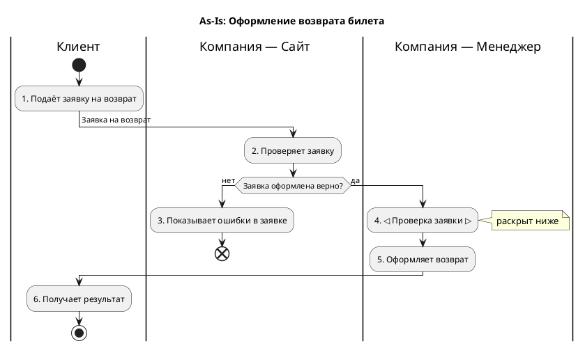

# BPMN-профиль для PlantUML (activity-нотация)

> Ресурс скилла `business-process-analyst`. У PlantUML нет нативной BPMN-нотации, поэтому документ использует профиль — фиксированное соответствие «элемент BPMN → конструкция activity-диаграммы». Все конструкции проверены рендером (PlantUML 1.2026). Диаграмма вне профиля — 🔴 на валидации.

## 1. Носитель

- Диаграмма — activity-диаграмма (новый синтаксис): пара `@startuml` / `@enduml`, дорожки `|Участник|`, поток `start … stop`.
- Файл `.puml` содержит один или несколько блоков `@startuml…@enduml` через пустую строку: первый — основной сценарий, следующие — раскрытые подпроцессы (рендерятся отдельными картинками `…_001.png` и т. д.). `newpage` в activity-диаграммах НЕ поддерживается.
- В документе `.md` те же блоки стоят в разделе 5 как fenced-блоки ```` ```plantuml ````; `.puml` = их содержимое подряд через пустую строку, побайтно.
- Формат — ТОЛЬКО PlantUML. Mermaid и «рисунки» текстом — 🔴.

## 2. Соответствие элементов

| Элемент BPMN | Конструкция профиля | Пример |
|---|---|---|
| Пул (организация) + дорожка (роль) | имя дорожки `<Пул> — <Роль>`; внешний участник без дорожек — `<Пул>` | `\|Компания — Менеджер\|`, `\|Клиент\|`, `\|Платёжный шлюз\|` |
| Старт-событие | `start`; тип события — подписью первой стрелки | `start` → `:1. Подаёт заявку;` |
| Задача | `:№. Кто + что;` — нумерация обязательна, совпадает с разделом 6 | `:2. Проверяет заявку;` |
| Свёрнутый подпроцесс | один шаг с маркером `◁ ▷` | `:5. ◁ Согласование ▷;` |
| Развёрнутый подпроцесс | `partition "Название" { … }` внутри одной дорожки | `partition "Проверка" { :3. …; :4. …; }` |
| Шлюз XOR (исключающее «или») | `if (Условие?) then (да) … else (нет) … endif` | `if (Возврат допустим?) then (да)` |
| Шлюз XOR с тремя и более ветками | `if … then … elseif … then … else … endif` | `if (Сумма до 1 000?) then (да) … elseif (Сумма до 10 000?) then (да) … else (свыше) … endif` |
| Шлюз AND (параллельность) | `fork … fork again … end fork`; каждая ветка заканчивается в дорожке слияния | `fork` / `:Готовит платёж;` / `fork again` / `:Отправляет уведомление;` / `end fork` |
| Шлюз OR (возможно несколько) | одним шлюзом не моделируется: независимые `if` подряд, каждый со своим условием | `if (Нужна подпись?) then (да) … endif`, затем `if (Нужен чек?) then (да) … endif` |
| Цикл с предусловием | `while (Условие продолжения?) is (да) … endwhile (нет)` | `while (Ответ не получен?) is (да)` … `endwhile (нет)` |
| Цикл с постусловием | `repeat … repeat while (Повторить?) is (да) not (нет)` | `repeat` … `repeat while (Есть ошибки?) is (да) not (нет)` |
| Промежуточное событие (таймер, сообщение) | задача-ожидание с типом события в скобках | `:7. Ждёт ответ клиента (таймер: 24 ч);` |
| Поток сообщений между участниками | переход в другую дорожку; подпись стрелки строкой после задачи | `:1. Подаёт заявку;` `-> Заявка на возврат;` `\|Сайт\|` |
| Завершение процесса (основной результат) | `stop` — один на блок, в конце основного сценария | `stop` |
| Альтернативное завершение (отказ, ошибка) | `end` (маркер ⊗) внутри ветки шлюза | `:3. Показывает отказ;` `end` |
| Комментарий | `note right` / `note left`; однострочный — `note right: текст` | `note right: [УТОЧНИТЬ] срок — вопрос бизнесу` |

## 3. Правила построения

1. **Дорожки = участники.** Имя — бизнес-имя. Внутренний пул — `<Компания> — <Роль>` (человек или система, например `Компания — Сайт`); внешний участник — `<Пул>`. ≤ 7 дорожек в блоке.
2. **Нумерация задач.** Каждый шаг — `:№. Действие;`; номер = строке раздела 6. Шлюзы, события и слияния не нумеруются. Свёрнутый подпроцесс — один номер; шаги его раскрытия — `:№.k. Действие;`.
3. **Подписи стрелок.** `-> Текст;` строкой после задачи или после `then (…)` / `else (…)`; текст — передаваемый объект или сообщение, на бизнес-языке.
4. **Условия — вопросами на бизнес-языке** с ответами `(да)` / `(нет)` либо конкретными вариантами (`(до 1 000)`, `(свыше)`).
5. **Основной сценарий и альтернативные завершения.** Основной сценарий проходит через все шлюзы к единственному `stop`. Альтернативное завершение — `end` в ПЕРВОЙ ветке шлюза (`then (нет)` … `end`, затем `else (да)`): `stop` в ветке до `else` — синтаксическая ошибка PlantUML.
6. **Параллельность.** Ветки `fork` начинаются и заканчиваются в дорожке владельца шага-слияния — иначе полосы разветвления и слияния рисуются в чужой дорожке. Не более 3 веток.
7. **Подпроцессы.** На основной диаграмме — `:N. ◁ Название ▷;` + `note right: раскрыт ниже`; раскрытие — следующий блок с `title <Процесс> — подпроцесс «<Название>»`.
8. **Запрещённые конструкции.** `kill` (не рисует ничего), `detach` (обрывает поток без маркера), `split` (ветвление без ромба), `newpage`, `stop` до `else`.
9. **Многострочный текст шага** — `\n` внутри метки: `:3. Проверяет заявку\n— сумма совпадает;`. Жирный — `<b>…</b>`. Угловые скобки `<` / `>` вне разметки, `|`, ведущий `#` и `;` внутри метки не используются.
10. **Язык.** Все подписи — на русском, на бизнес-языке (раздел 3 методологии): без эндпоинтов, таблиц и классов.
11. **Стиль.** Второй строкой блока (после `title`) — `skinparam shadowing false`; `skinparam monochrome true` НЕ применяется — гасит заливки цветового измерения.

## 4. Цвет и легенда

Цвет — необязательное **одно измерение** на диаграмму; As-Is по умолчанию бесцветный. Измерение фиксируется в мета-строке документа и расшифровывается в `legend` каждого блока, где использован цвет.

| Измерение | Когда | Стереотипы и заливки |
|---|---|---|
| Изменения To-Be | режим To-Be | `<<new>>` `#CCFFCC` — новый шаг; `<<changed>>` `#FFF2CC` — меняется; `<<removed>>` `#FFD5D5` — удаляется; бесцветный — без изменений |
| Способ выполнения | As-Is, когда дорожки не показывают, кто выполняет шаг — человек или система | `<<manual>>` `#FFD5D5` — вручную; `<<auto>>` `#CCFFCC` — автоматически; бесцветный — не классифицирован |

Синтаксис — ТОЛЬКО стереотип после задачи + `skinparam activity`:

```plantuml
skinparam activity {
  BackgroundColor<<manual>> #FFD5D5
  BackgroundColor<<auto>>   #CCFFCC
}
|Клиент|
start
:1. Подаёт заявку; <<manual>>
```

Синтаксис `#HEX:Текст;` (цвет перед меткой) ЗАПРЕЩЁН: устаревший, при рендере «съедает» следующий шаг.

Легенда — `legend right … end legend` в конце блока, таблицей с плашками `<back:#HEX>`:

```plantuml
legend right
  |= Цвет |= Значение |
  |<back:#FFD5D5>      </back>| Вручную |
  |<back:#CCFFCC>      </back>| Автоматически |
end legend
```

Взаимная полнота: каждый использованный HEX расшифрован, каждая строка легенды соответствует используемому HEX; «бесцветный = …» описан строкой, если есть бесцветные шаги.

## 5. Скелет основного блока



Полный проверенный пример (основной блок + раскрытие подпроцесса, `fork`, `end`) — `examples/bpmn_example_ticket_refund.puml`.
