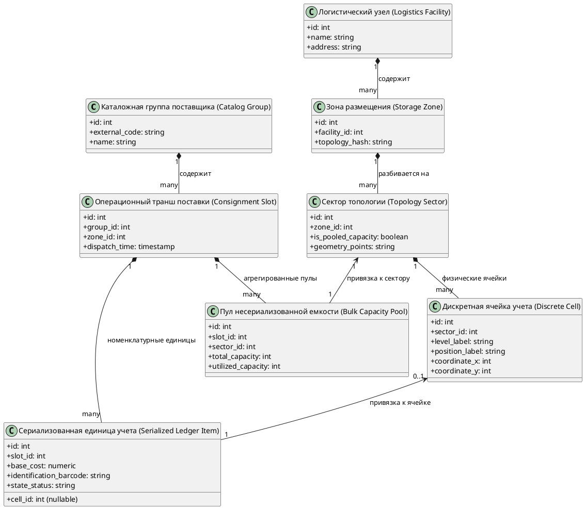
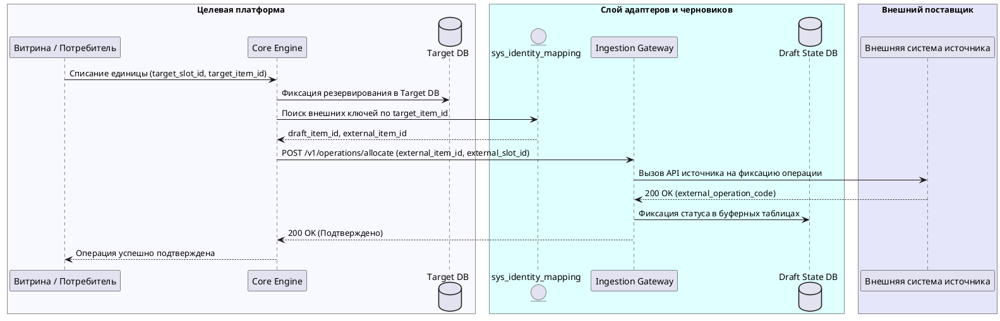

# Доменный и интеграционный аудит As-Is: Сервис синхронизации внешних поставок и материальных ресурсов

## 1. Введение и цели аудита

Настоящий аудит подготовлен в рамках задачи рефакторинга/миграции слоя интеграции в сервисе `resource-ingestion-service`.
Цель аудита — восстановить полную доменную модель данных, включая атомарные листовые сущности, зафиксировать фактический след персистентности в кодовой базе и выявить расхождения контрактов до проектирования целевой архитектуры.

Анализируемые репозитории и хранилища:
- Репозиторий: `services/resource-ingestion` (Java / Spring Boot);
- База данных адаптера и трансляции ключей: `ingestion_state_db` (PostgreSQL);
- Заменяемое целевое хранилище As-Is: `legacy_ledger_db` (реляционная СУБД).

---

## 2. Иерархическое дерево доменных сущностей (Domain Entity Tree)

### 2.1 Диаграмма структуры домена

### 2.2 Реестр сущностей до листовых элементов

| Уровень | Сущность | Тип идентификатора | Листовая? | Описание и назначение |
|---------|----------|-------------------|-----------|------------------------|
| 1 (Корень) | Каталожная группа (`Catalog Group`) | `int` (`GroupKey`) | Нет | Корневой агрегат описания номенклатурного потока |
| 2 (Контекст) | Логистический узел (`Logistics Facility`) | `int` (`FacilityKey`) | Нет | Физический объект размещения |
| 3 (Топология) | Зона размещения (`Storage Zone`) | `int` (`ZoneKey`) | Нет | Конфигурация зоны с вычислением хэша топологии |
| 4 (Топология) | Сектор (`Topology Sector`) | `int` (`SectorKey`) | Нет | Логический сегмент зоны (полигон, признак пула) |
| 5 (Лист) | Дискретная ячейка учета (`Discrete Cell`) | `int` (`CellKey`) | **Да** | Физическая квантованная позиция (уровень, ряд, координаты) |
| 2 (Операции) | Операционный транш (`Consignment Slot`) | `int` (`SlotKey`) | Нет | Сессия поставки с привязкой к дате и зоне |
| 6 (Лист) | Сериализованная единица (`Serialized Ledger Item`) | `int` (`ItemKey`) | **Да** | Единичная номенклатурная позиция с атрибутами цены, штрих-кода и статуса |
| 6 (Лист) | Пул несериализованной емкости (`Bulk Capacity Pool`) | `int` (`PoolKey`) | **Да** | Квотируемый объем ресурсов без индивидуального позиционирования |

---

## 3. Реестр механизмов хранения и адаптеров (Persistence Footprint)

| Сущность | Адаптер в кодовой базе | Хранимые процедуры / SQL As-Is | Таблицы сопоставления (`Identity Maps`) |
|----------|------------------------|-------------------------------|-----------------------------------------|
| Каталожная группа | `CatalogBatchImporter.java:120` | `sp_RegisterCatalogGroup`, `sp_UpdateCatalogGroup` | `ingestion_state_db.sys_crossref (type='GROUP')` |
| Зона размещения | `TopologySyncService.java:85` | `sp_CreateStorageZone`, `sp_UpdateStorageZone` | `ingestion_state_db.sys_crossref (type='ZONE')` |
| Секторы топологии | `SectorProcessor.java:64` | `sp_CreateTopologySector`, `sp_BindSector` | `ingestion_state_db.sys_crossref (type='SECTOR')` |
| Дискретные ячейки | `CellBatchWriter.java:140` | `sp_InsertCellsBatch`, `sp_UpdateCellAttributes` | `ingestion_state_db.sys_crossref (type='CELL')` |
| Операционные транши | `ConsignmentRepository.java:95` | `sp_CreateConsignmentSlot`, `sp_DeactivateSlot` | `ingestion_state_db.sys_crossref (type='SLOT')` |
| Номенклатурные единицы | `ItemStateSynchronizer.java:210` | `sp_MarkItemAvailable`, `sp_MarkItemAllocated` | Прямое обновление статусов в `legacy_ledger_db` |
| Пулы емкости | `PooledQuotaManager.java:78` | `sp_AllocateVirtualQuotaBatch` | `ingestion_state_db.quota_crossref` |

---

## 4. Матрица конфликта контрактов и типов (Impedance Mismatch Matrix)

| Сущность / Атрибут | Модель источника (As-Is) | Модель целевой системы (To-Be) | Характер конфликта | Архитектурное решение для спецификации |
|-------------------|--------------------------|--------------------------------|-------------------|---------------------------------------|
| Первичные ключи всех сущностей | `Integer` (32-bit int) | `String` (UUID / BSON ObjectId) | Несовместимость типов идентификаторов | Введение таблицы трансляции идентификаторов `sys_identity_mapping` |
| Номер позиции (`position_label`) | `String` (буквенно-цифровые индексы) | `Integer` (строго числовое поле) | Валидационный отказ сериализации | Хранение сырого значения в буфере черновиков и нормализация при публикации |
| Время завершения транша | Отсутствует в источнике (`null`) | Обязательный атрибут `expiry_time` | Нарушение схемы целевого контракта | Синтетический расчет планового времени завершения по бизнес-правилу |
| Дедупликация топологии зоны | Вычисление контрольной суммы (хэша) ячеек | Сравнение по внешнему коду логистического узла | Риск создания дублирующих топологий | Сохранение алгоритма хэширования в интеграционном слое черновиков |

---

## 5. Анализ контуров управления и администрирования (Control Plane)

### 5.1 Топология взаимодействия
- **Панель администрирования (Admin UI):** Оператор регистрирует внешнего поставщика, устанавливает коэффициенты наценки/тарифов и привязывает параметры договора.
- **Маршрутизация:** Панель администрирования обращается к шлюзовому сервису, не вмешиваясь напрямую в транзакционное ядро.

### 5.2 Бизнес-соглашения и взаиморасчеты
- В As-Is параметры поставщиков хранятся в модуле договорных условий (`ContractTerms`).
- При исполнении операций реализуется цепочка взаиморасчетов между участниками процесса.
- В To-Be контур управления обязан материализовать условия интеграционного соглашения до запуска синхронизации потока единиц учета.

---

## 6. Обратная трассировка ключевого сценария (Reverse Lineage)

### 6.1 Сценарий: Клиентское списание единицы учета в целевой системе

---

## 7. Критические архитектурные выводы для последующих этапов

1. **Недопустимость изоляции агрегатов без листовых сущностей:** Любая целевая архитектура обязана поддерживать атомарные идентификаторы позиций и секторов на этапе интеграции, иначе внутренние модули пакетной обработки завершатся фатальным сбоем.
2. **Обязательность двухфазной публикации данных:** Из-за несовместимости типов валидации данных сырые транши и топологии должны поступать в буферное хранилище черновиков с последующей нормализацией и операторской верификацией.
3. **Реализация двусторонней трансляции идентификаторов:** В системных требованиях обязана присутствовать таблица сопоставления ключей `sys_identity_mapping`, покрывающая все уровни доменной модели.
