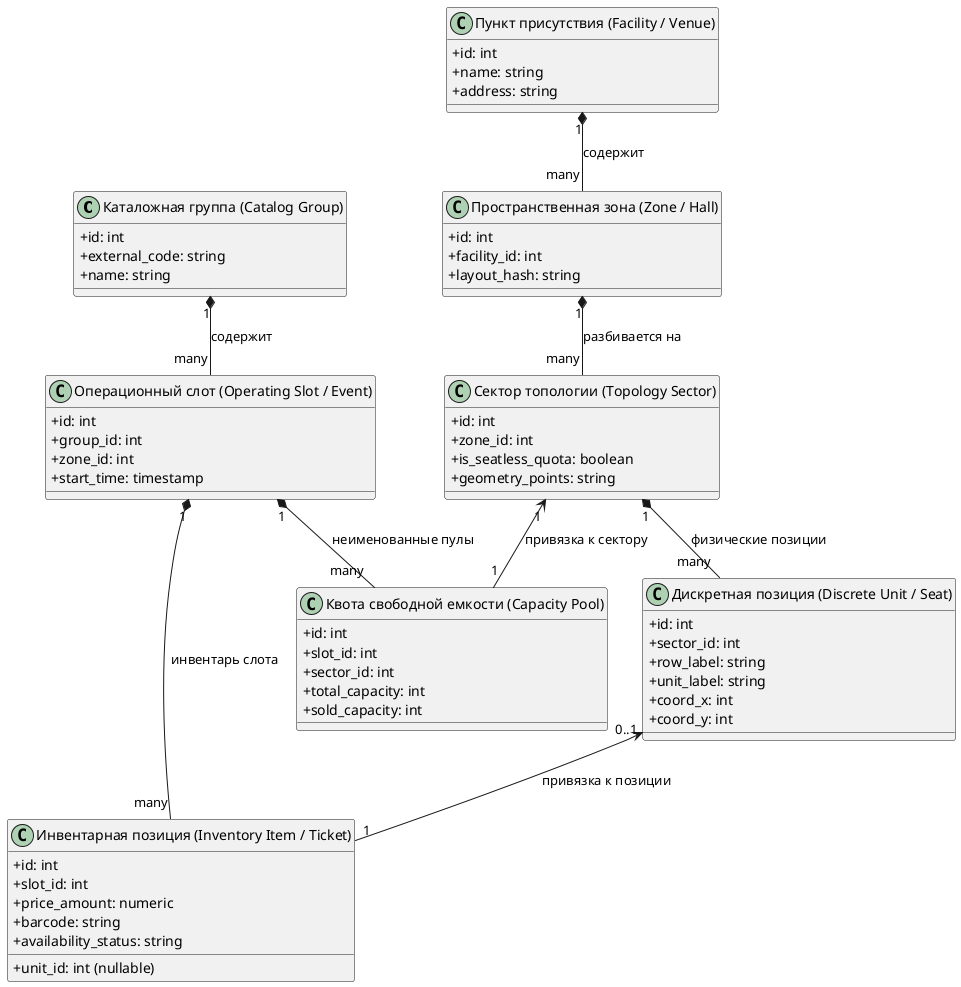
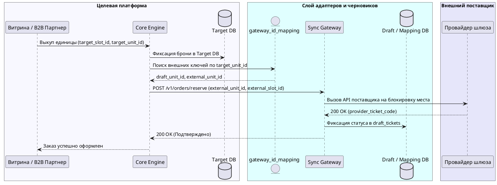

# Доменный и интеграционный аудит As-Is: Сервис синхронизации инвентаря

## 1. Введение и цели аудита

Настоящий аудит подготовлен в рамках задачи рефакторинга/миграции слоя сохранения данных в сервисе `provider-sync-service`.
Цель аудита — восстановить полную доменную модель данных, включая атомарные листовые сущности, зафиксировать фактический след персистентности в кодовой базе и выявить расхождения контрактов до проектирования целевой архитектуры.

Анализируемые репозитории и хранилища:
- Репозиторий: `services/provider-sync` (Java / Spring);
- База данных источника/маппинга: `sync_db` (PostgreSQL);
- Заменяемое хранилище данных As-Is: `legacy_core_db` (MS SQL Server / Oracle).

---

## 2. Иерархическое дерево доменных сущностей (Domain Entity Tree)

### 2.1 Диаграмма структуры домена

### 2.2 Реестр сущностей до листовых элементов

| Уровень | Сущность | Тип идентификатора | Листовая? | Описание и назначение |
|---------|----------|-------------------|-----------|------------------------|
| 1 (Корень) | Каталожная группа (`Catalog Group`) | `int` (`GroupKey`) | Нет | Корневой агрегат описания события/услуги |
| 2 (Контекст) | Площадка (`Facility`) | `int` (`FacilityKey`) | Нет | Физическое здание или комплекс |
| 3 (Топология) | Пространственная зона (`Zone`) | `int` (`ZoneKey`) | Нет | Зал или конфигурация площадки с вычислением MD5-хэша схемы |
| 4 (Топология) | Сектор (`Sector`) | `int` (`SectorKey`) | Нет | Логический сегмент схемы (полигон, признак квоты) |
| 5 (Лист) | Дискретная позиция (`Discrete Unit`) | `int` (`UnitKey`) | **Да** | Физическое квантованное место (ряд, номер, координаты) |
| 2 (Операции) | Операционный слот (`Operating Slot`) | `int` (`SlotKey`) | Нет | Конкретный сеанс/дата проведения с привязкой к зоне |
| 6 (Лист) | Инвентарная позиция (`Inventory Item`) | `int` (`ItemKey`) | **Да** | Единичный билет слота с номиналом цены, баркодом и статусом доступности |
| 6 (Лист) | Квота емкости (`Capacity Pool`) | `int` (`PoolKey`) | **Да** | Виртуальный пул свободной рассадки (входные билеты без номера места) |

---

## 3. Реестр механизмов хранения и адаптеров (Persistence Footprint)

| Сущность | Адаптер в кодовой базе | Хранимые процедуры / SQL As-Is | Таблицы сопоставления (`Mapping`) |
|----------|------------------------|-------------------------------|-----------------------------------|
| Каталожная группа | `RepertoireImporter.java:366` | `dbo.sp_AddGroup`, `dbo.sp_UpdateGroup` | `sync_db.dbo.mapping (type='GROUP')` |
| Пространственная зона | `ConstructiveImporter.java:230` | `dbo.sp_CreateZone`, `dbo.sp_UpdateZone` | `sync_db.dbo.mapping (type='ZONE')` |
| Секторы и полигоны | `SectorImporter.java:115` | `dbo.sp_CreateSector`, `dbo.sp_LinkSector` | `sync_db.dbo.mapping (type='SECTOR')` |
| Дискретные позиции | `UnitEntityImporter.java:180` | `dbo.sp_AddUnitsBatch`, `dbo.sp_UpdateUnit` | `sync_db.dbo.mapping (type='UNIT')` |
| Операционные слоты | `SlotRepository.java:85` | `dbo.sp_AddSlotLite`, `dbo.sp_HideSlot` | `sync_db.dbo.mapping (type='SLOT')` |
| Инвентарь и цены | `InventoryImporter.java:270` | `dbo.sp_MarkUnitFree`, `dbo.sp_MarkUnitSold` | Прямое обновление статуса в `legacy_core_db` |
| Квоты емкости | `QuotaRepository.java:92` | `dbo.sp_InsertVirtualPoolItems` | `sync_db.dbo.quota_mappings` |

---

## 4. Матрица конфликта контрактов и типов (Impedance Mismatch Matrix)

| Сущность / Атрибут | Модель источника (As-Is) | Модель целевой системы (To-Be) | Характер конфликта | Архитектурное решение для спецификации |
|-------------------|--------------------------|--------------------------------|-------------------|---------------------------------------|
| Первичные ключи всех сущностей | `Integer` (32-bit int) | `String` (24 hex BSON ObjectId) | Несовместимость типов идентификаторов | Введение реляционной таблицы трансляции `gateway_id_mapping` |
| Номер позиции (`unit_label`) | `String` (допускает "1А", "VIP-2") | `Integer` (строго число) | Валидационный отказ при сериализации | Хранение сырого значения в черновиках и нормализация при публикации |
| Время окончания слота | Не передается источником (`null`) | Обязательное поле `end_time` (not null) | Нарушение контракта создания | Расчет синтетического времени окончания (`start_time + 3 hours`) |
| Дедупликация схемы зоны | Вычисление MD5 от массива мест | Сравнение по внешнему идентификатору площадки | Риск размножения схем-дубликатов | Сохранение хэширования топологий на этапе черновиков |

---

## 5. Анализ контуров управления и администрирования (Control Plane)

### 5.1 Топология взаимодействия
- **Панель управления (Admin UI):** Оператор настраивает подключение к внешнему шлюзу поставщика, задает процент комиссии и привязывает организатора.
- **Маршрутизация:** Панель управления обращается к шлюзовому адаптеру как к прокси, исключая прямое вмешательство в целевое ядро.

### 5.2 Коммерческие условия и клиринг
- В As-Is договоры поставщиков хранятся в модуле финансовых условий (`ContractClauses`).
- При продажах реализуется трехсторонняя модель клиринга: `Поставщик <-> Агрегатор/МДТЗК <-> B2B-партнер`.
- В To-Be контур управления обязан материализовать условия сделки (`Deal`) до старта операционной синхронизации инвентаря.

---

## 6. Обратная трассировка ключевого сценария (Reverse Lineage)

### 6.1 Сценарий: Клиентский выкуп инвентарной единицы в целевой системе

---

## 7. Критические архитектурные выводы для последующих этапов

1. **Недопустимость отрыва без листовых таблиц:** Любая архитектура To-Be обязана поддерживать целочисленные идентификаторы для позиций и секций на этапе интеграции с адаптером, иначе внутренний код `UnitEntityImporter` завершится фатальным сбоем.
2. **Обязательность двухфазной публикации инвентаря:** Из-за несовместимости типов валидации данных сырые слоты и топологии должны поступать в буферную базу черновиков, проходя автоматическую нормализацию и операторскую верификацию.
3. **Реализация обратного шлюзового моста:** В спецификации требований обязана присутствовать таблица трансляции ключей `gateway_id_mapping`, покрывающая все 7 уровней доменной модели.
