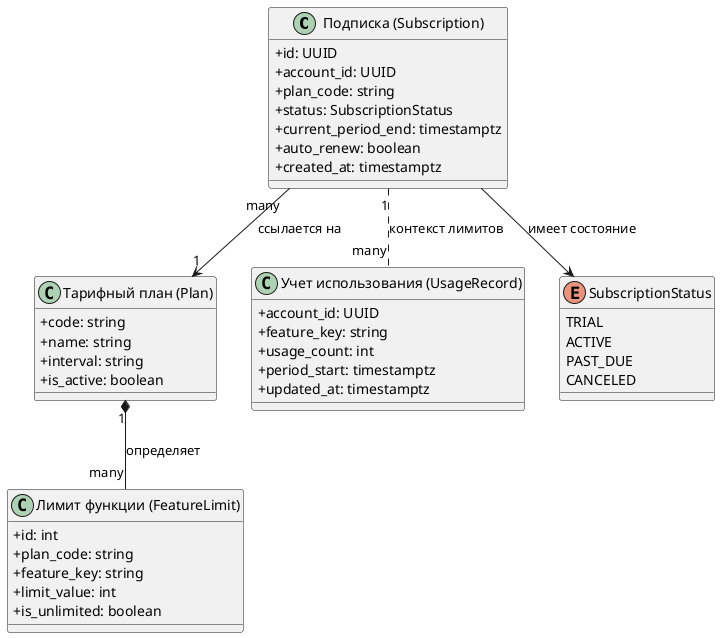
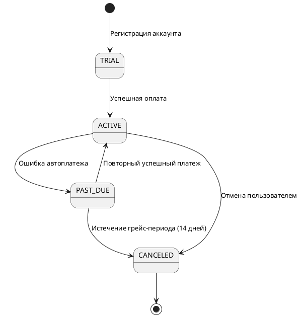
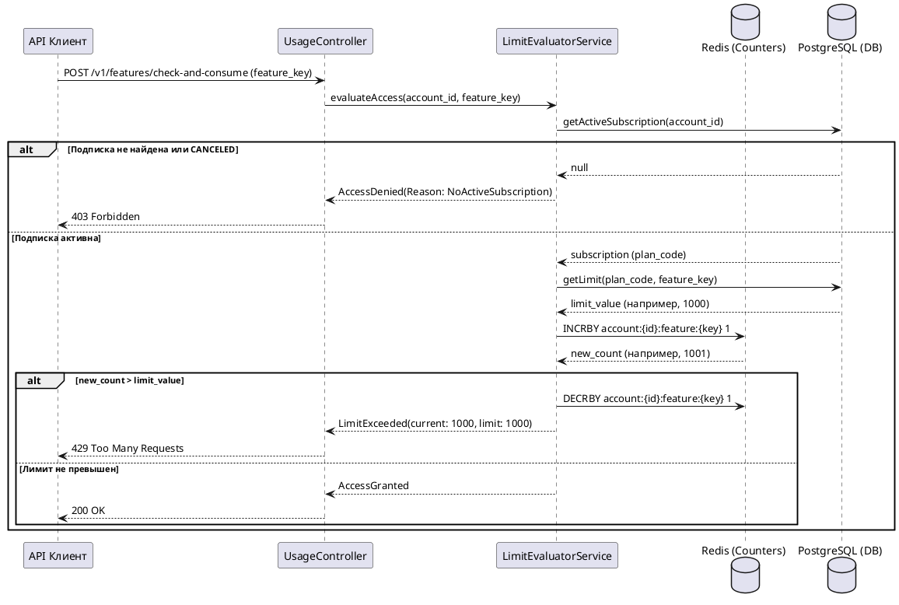

# Доменный и технический аудит: Модуль управления подписками и лимитами использования

## 1. Введение и цели аудита

Настоящий аудит подготовлен в рамках задачи расширения логики тарификации и контроля квот в сервисе `subscription-service`.
Цель аудита — проанализировать фактические структуры данных в кодовой базе, механизмы хранения, параметры конфигурации и обработку нештатных ситуаций перед проектированием концептов и системных требований.

Анализируемые компоненты кодовой базы:
- Пакет доменных моделей: `src/domain/subscription/`;
- Слой хранения и репозиториев: `src/infrastructure/repositories/`;
- Конфигурации и параметры сервиса: `config/application.yml`.

---

## 2. Модель данных и доменные сущности (Data & Entity Model)

### 2.1 Диаграмма структуры сущностей

### 2.2 Спецификация атрибутов и типов данных

| Сущность | Атрибут | Тип данных | Обязательность | Описание и ограничения |
|----------|---------|------------|----------------|------------------------|
| `Subscription` | `id` | `UUID` | Обязательное | Первичный ключ подписки |
| `Subscription` | `account_id` | `UUID` | Обязательное | Владелец подписки; уникальный индекс в паре с `status=ACTIVE` |
| `Subscription` | `plan_code` | `string(64)` | Обязательное | Код тарифного плана |
| `Subscription` | `status` | `enum` | Обязательное | Допустимые значения: `TRIAL`, `ACTIVE`, `PAST_DUE`, `CANCELED` |
| `Subscription` | `current_period_end` | `timestamptz` | Обязательное | Время окончания текущего расчетного периода |
| `FeatureLimit` | `limit_value` | `int` | Обязательное | Максимальное число операций в рамках периода |
| `UsageRecord` | `usage_count` | `int` | Обязательное | Текущее накопленное количество использований |

---

## 3. Слой персистентности и жизненный цикл состояния

### 3.1 Механизмы хранения
- **Реляционное хранилище:** таблицы `subscriptions`, `plans`, `feature_limits` в PostgreSQL (`SubscriptionEntity.kt:42`).
- **Быстрый счетчик использования:** значения `usage_count` кэшируются и инкрементируются атомарно в Redis (`UsageRedisRepository.kt:18`) с периодическим сбросом в основное хранилище.

### 3.2 Жизненный цикл состояния подписки

---

## 4. Конфигурация и управление поведением

Поведение модуля параметризуется через конфигурацию сервиса (`config/application.yml:55`):
- `billing.grace-period-days` (по умолчанию: `14`) — длительность ожидания оплаты в статусе `PAST_DUE` до перевода в `CANCELED`;
- `limits.enforcement-mode` (значения: `BLOCKING` / `WARNING_ONLY`) — стратегия поведения при исчерпании лимита;
- `features.overage-allowed` — флаг разрешения перерасхода лимитов.

---

## 5. Сквозной поток исполнения и сценарии отказов

### 5.1 Сценарий: Проверка и учет использования функции

### 5.2 Поведение в нештатных ситуациях
1. **Недоступность Redis:** при сбое кэша сервис переключается на прямой запрос к PostgreSQL (`fallbackToDatabase: true`, `UsageEvaluator.kt:88`).
2. **Конкурентные запросы:** инкремент счетчика выполняется атомарной командой, что исключает состояние гонки при одновременных обращениях.

---

## 6. Выводы и архитектурные ограничения

1. **Необходимость учета состояния подписки:** Любые новые методы или проверки обязаны валидировать статус `ACTIVE` / `TRIAL`, иначе возможен несанкционированный доступ к функциям аккаунтов в статусе `PAST_DUE`.
2. **Атомарность учета:** При расширении модели данных на составные квоты необходимо сохранить атомарный характер проверки и списания для предотвращения превышения лимитов при параллельных запросах.
