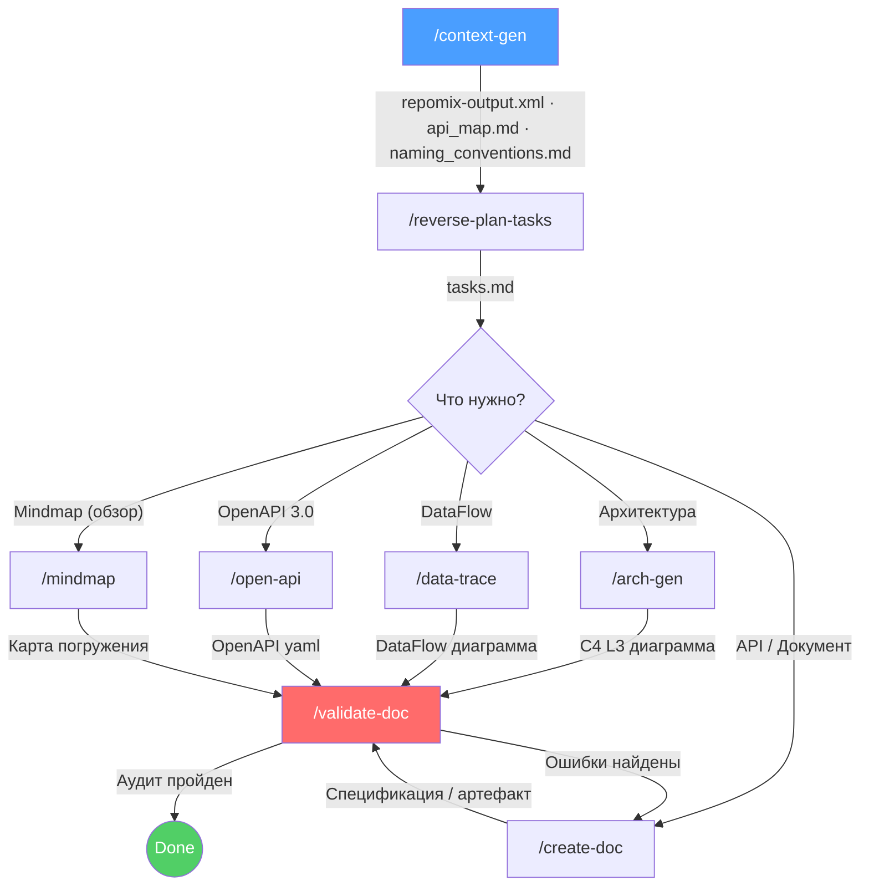
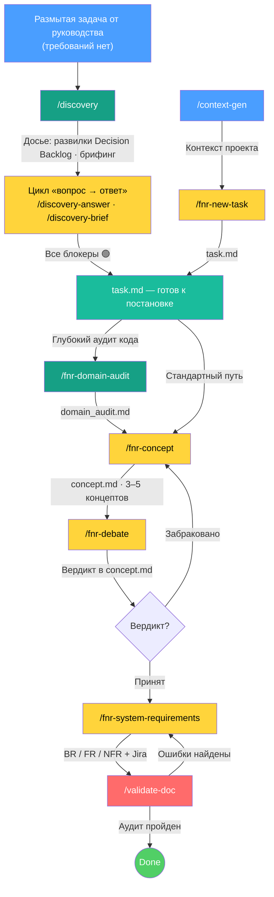
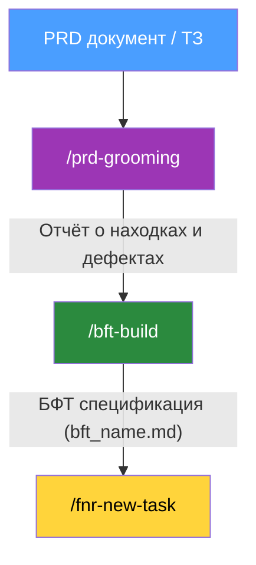
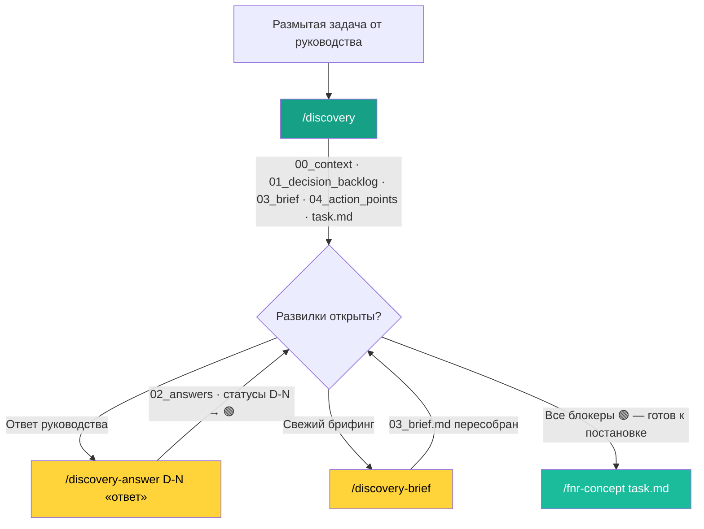
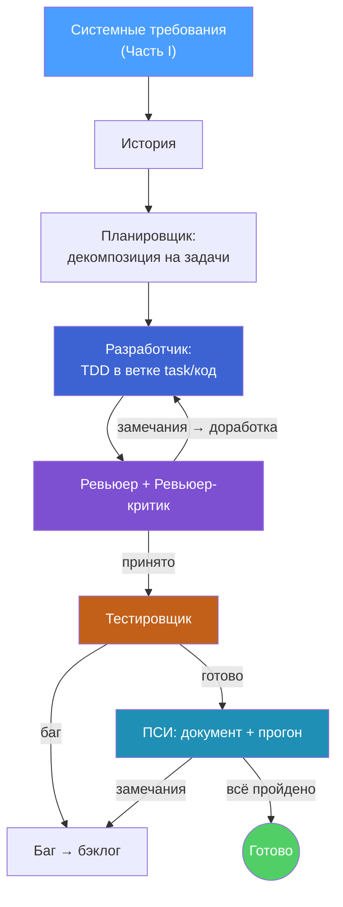

<p align="center">
  <strong>System Analyst Helper</strong><br>
  <em>Промышленный фреймворк для&nbsp;ИИ‑агентов: реверс‑инжиниринг, документация, системные требования, автономная разработка</em>
</p>

<p align="center">
  
  
  
  
</p>

---

> **Реверс‑инжиниринг** — превращайте код в C4‑диаграммы, DataFlow, API‑спецификации и mindmap‑карты погружения.<br>
> **Системные требования** — проходите путь от проблемы до формального BR/FR/NFR с Jira‑декомпозицией.<br>
> **Discovery** — превращайте размытую постановку в конкретные вопросы‑развилки для руководства и брифинг для согласования.<br>
> **Разработка** — AI-Harness: задачи едут по конвейеру сами, агенты работают в git-worktree, человек управляет из веб-интерфейса и чатом Eve.
>
> Ключевой принцип — **нулевой допуск к галлюцинациям**: каждый факт прослеживается до строки кода (Traceability).

---

## Содержание

- [Быстрый старт (Установка)](#-быстрый-старт-установка)
- [Часть I — Аналитика](#часть-i--аналитика)
  - [Процессы и диаграммы](#-процессы-и-диаграммы)
- [Доступные команды](#-доступные-команды-18-команд)
- [Часть II — Разработка (AI-Harness)](#часть-ii--разработка-ai-harness)
  - [Как работать: пошагово](#как-работать-пошагово)
  - [Задачи и автомат](#задачи-и-автомат)
  - [Агенты и конвейер](#-агенты-и-конвейер)
  - [Подъём в Docker](#-подъём-в-docker)
- [Стандарт Doc-Architect v3.0](#-стандарт-doc-architect-v30)
- [Структура системы](#-структура-системы)
- [Структура sa_documentation](#-структура-sa_documentation)
- [Применение на практике](#применение-на-практике)

---

## ⚡ Быстрый старт (Установка)

Разверните SA-Helper в проекте одной командой:

<!-- prettier-ignore -->
| Платформа | Команда |
|-----------|---------|
| **macOS / Linux** | `curl -sSL https://raw.githubusercontent.com/boboden541/sa-helper/main/install.sh \| bash` |
| **Windows (Git Bash)** | `curl --ssl-no-revoke -sSL https://raw.githubusercontent.com/boboden541/sa-helper/main/install.sh -o /tmp/sa-install.sh && bash /tmp/sa-install.sh && rm -f /tmp/sa-install.sh` |

> **Обновление после правок эталонов и ресурсов.** Команды и навыки работают с **установленной** копией в вашем проекте. Если изменились эталоны (`examples/`) или ресурсы навыков (`resources/`) — запустите установку повторно, иначе установленная копия останется на прежней версии и команды продолжат работать по старым правилам.

### Что произойдёт

Скрипт спросит, какой IDE‑агент вы используете:

| | 1. Claude Code | 2. Antigravity | 3. Codex | 4. OpenCode | 5. Cline | 6. DevX (МТС) | 7. Universal | 8. Cursor | 9. Windsurf | 10. Roo Code | 11. Continue | 12. GitHub Copilot | 13. Aider |
|:---|:---|:---|:---|:---|:---|:---|:---|:---|:---|:---|:---|:---|:---|
| **Корень** | `.claude/` | `.agent/` | `.agents/` | `.opencode/` | `.cline/` | `.clinerules/` | `.agents/` | `.cursor/` | `.windsurf/` | `.roo/` | `.continue/` | `.github/` | `.aider/` |
| **Команды** | `commands/` | `workflows/` | `prompts/` | `commands/` | `workflows/` | `workflows/` | `commands/` | `rules/` | `rules/` | `workflows/` | `prompts/` | `prompts/` | `prompts/` |
| **Навыки** | `skills/` | `skills/` | `skills/` | `skills/` | `skills/` | `skills/` | `skills/` | `skills/` | `skills/` | `skills/` | `skills/` | `skills/` | `skills/` |


> Существующие файлы не удаляются — обновляются только управляемые подпапки.

---

### 🔧 Продвинутая настройка (Алиас `init_sa`)

#### macOS / Linux

1. Определите шелл: `echo $SHELL`
   - `/bin/zsh` → `~/.zshrc`
   - `/bin/bash` → `~/.bashrc`
2. Запишите алиас:

```bash
echo "alias init_sa='curl -sSL https://raw.githubusercontent.com/boboden541/sa-helper/main/install.sh -o /tmp/sa-install.sh && bash /tmp/sa-install.sh && rm -f /tmp/sa-install.sh'" >> ~/.zshrc
```

1. Примените: `source ~/.zshrc`
2. Проверьте: введите `init_sa` в любой папке проекта.

<details>
<summary>Обновление старого алиаса</summary>

```bash
# zsh
sed -i '' '/alias init_sa/d' ~/.zshrc
echo "alias init_sa='curl -sSL https://raw.githubusercontent.com/boboden541/sa-helper/main/install.sh -o /tmp/sa-install.sh && bash /tmp/sa-install.sh && rm -f /tmp/sa-install.sh'" >> ~/.zshrc

# bash — замените sed -i '' на sed -i
sed -i '/alias init_sa/d' ~/.bashrc
echo "alias init_sa='curl -sSL https://raw.githubusercontent.com/boboden541/sa-helper/main/install.sh -o /tmp/sa-install.sh && bash /tmp/sa-install.sh && rm -f /tmp/sa-install.sh'" >> ~/.bashrc
```

</details>

#### Windows

> Требуется Git Bash (ставится вместе с Git for Windows).

Откройте профиль PowerShell:

```powershell
notepad $PROFILE
```

Добавьте функцию:

```powershell
function init_sa {
    $tempDir = Join-Path $env:TEMP "sa-helper-$(Get-Random)"
    git clone --depth 1 https://github.com/boboden541/sa-helper.git $tempDir
    bash "$tempDir\install.sh"
    Remove-Item -Recurse -Force $tempDir -ErrorAction SilentlyContinue
}
```

> **После установки перезагрузите IDE** (Reload Window), чтобы команды появились в чате.

---

## 🔄 Обновление

Запустите команду установки повторно — скрипт обновит только управляемые файлы.

| Платформа | Действие |
|-----------|----------|
| **macOS / Linux** | `init_sa` или curl‑команда из быстрого старта |
| **Windows** | `init_sa` или git‑clone‑команда из быстрого старта |

---

# Часть I — Аналитика

Инструменты, которые помогают понять систему и подготовить требования:
реверс-инжиниринг, системные требования (FNR Pipeline), груминг PRD, discovery.

## 📊 Процессы и диаграммы

### Процесс 1: Реверс‑инжиниринг и документация



### Процесс 2: Системные требования (FNR Pipeline)

У процесса **два входа**:

- **Задача понятна** → постановка через анализ проблемы: `/fnr-new-task` формирует `task.md`.
- **Задача от руководства размыта, требований нет** → discovery‑этапы (`/discovery` → цикл вопросов‑ответов `/discovery-answer` / `/discovery-brief`), которые закрывают развилки и готовят тот же `task.md` (детали — Процесс 4).

Дальше пути сходятся: `/fnr-concept` → `/fnr-debate` → `/fnr-system-requirements` → `/validate-doc`.



### Процесс 3: Анализ требований (PRD Grooming & BFT)



### Процесс 4: Discovery (формирование требований)

Когда задача от руководства размыта и требований нет: `/discovery` собирает контекст, находит развилки (Decision Backlog), формирует брифинг для согласования и action points. По мере ответов руководства досье обновляется, пока не будет готово к постановке (`/fnr-concept`).



---

# Часть II — Разработка (AI-Harness)

Вторая половина инструмента: утверждённые системные требования превращаются в работающий код.
**AI-Harness — task-tracker плюс автомат вокруг него.** Канбан-доска и статусные модели для пяти типов задач, а поверх — фоновый демон и ИИ-агенты: они сами ведут задачу от декомпозиции до приёмо-сдаточных испытаний. Человек управляет из веб-интерфейса и словами через чат Eve; форс-переходы и приёмка работы — только человек.

## Как работать: пошагово

| Шаг | Что делать | Где |
|---|---|---|
| 1 | **Поднять стек** и демо-данные (см. [Подъём в Docker](#-подъём-в-docker)) | http://localhost:8088 |
| 2 | **Подключить ИИ-провайдера** и **папку инструментов** — `.claude` установленного SA-Helper, один путь на все проекты | Настройки → ИИ-провайдеры / Инструменты |
| 3 | **Создать историю** и вставить текст СТ: Планировщик декомпозирует её на задачи; если СТ неполные — агент вернёт вопросы, а не додумает | «+ Задача» → история |
| 4 | **Наблюдать**: канбан двигается сам; на доске, в списке и в карточке видно, какой агент работает прямо сейчас, сколько минут и токенов, и что он делает — хроника обновляется живьём | витрина |
| 5 | **Управлять**: кнопки переходов и форс (с обязательной причиной), перехват задачи у агента, чат Eve: «почему SA-13 не двигается?», «переведи SA-11 на ревью», «создай задачу: …» | карточка / 💬 Eve |
| 6 | **Проверить и принять**: ПСИ-составитель готовит документ ПСИ по истории (сохраняется файлом в папку FNR, например `…/FNR/FNR_8/psi.md`); человек выполняет прогон «действие → ожидаемый результат» и принимает работу | карточка истории |



## Задачи и автомат

Автомат построен на задачах: у каждого типа — своя статусная модель, и добавить новый тип задач значит «спроектировать» статусную модель в настройках, без программирования. Задачи в полёте живут по своей версии правил — публикация новой версии не ломает идущие работы.

| Тип | Для чего | Путь |
|:----|:---------|:-----|
| **История** | большая фича | декомпозируется на задачи → когда все закрыты — сквозное тестирование с ПСИ |
| **Задача** | разработка | декомпозиция → разработка → ревью → тестирование; замечания возвращают на доработку |
| **QA-задача** | проверка без кода | чеклист и отчёт в формате ПСИ: любой человек воспроизводит проверку как по инструкции |
| **Баг** | исправление | чеклист «как воспроизвести и как исправить», без код-ревью, с повторным тестом |
| **Анализ** | проектирование решения | требования → изыскания → концепты → выбор → системные требования |

**История движется сама** (зеркалирование): дочернюю задачу взяли в работу — история «в работе»; всё закрыто — на тестирование; найдены баги — заблокирована; ПСИ пройден без замечаний — «готово», и это подтверждает человек. Каждое срабатывание правила — запись в хрониках истории.

**Право на переход.** Человек — любые переходы и форс (даже из «готово», только с причиной). Агент — работа на своём статусе. Автомат — только детерминированные правила, без «инициативы». Чеклист-гейт: без созданного чеклиста этапа задача не берётся в работу, с незакрытыми пунктами — не передаётся дальше. Если агенту не удалось (провайдер, таймаут, исчерпаны попытки) — задача уходит в «заблокировано» с формулировкой «требуется участие человека».

## 🤖 Агенты и конвейер

Демон сам находит задачи на статусах с назначенным агентом, атомарно резервирует их (двойное взятие исключено) и запускает прогоны. На один статус можно назначить несколько агентов: «параллельно» — работают одновременно, «замещение» (по умолчанию) — работает один, при сбое подхватывает следующий.

| Пресет-агент | Что делает |
|:-------------|:-----------|
| **Планировщик** | декомпозирует истории и задачи, готовит чеклист разработчика и контекст прогона |
| **Разработчик** | TDD-разработка в ветке `task/<код>`: чеклист, осмысленные коммиты, отчёт |
| **Ревьюер** | независимое ревью диффа и отчёта по чеклисту ревьюера |
| **Ревьюер-критик** | второе независимое ревью — строгость к краевым случаям |
| **Тестировщик** | чеклист тестирования и отчёт; для qa_task — в формате ПСИ |
| **Аналитик** | требования, концепты, спецификация |
| **ПСИ-составитель** | документ ПСИ по истории: версии, прогон, файл в папке FNR |

**Как устроен прогон.** Агент запускается headless (Claude Agent SDK) в git-worktree задачи — ветка `task/<код>` от базовой ветки проекта. Слияние в базовую ветку делает демон перед «готово»; конфликт — задача заблокирована, распутывает человек. Промт = персона «Имя — роль» + контекст задачи + назначенные скиллы + контракт отчёта: свободного текста у агента нет, методологии живут в скиллах. Отчёт — строгий JSON: статус, сводка, обновления чеклиста, артефакт, предложенный переход, вопросы и комментарии человеку (они попадают в карточку от имени агента).

**SA-Helper внутри конвейера.** Инструментарий задаётся одним глобальным путём на все проекты (папка `.claude` установленного SA-Helper) и подключается к worktree живой ссылкой — симлинк (Windows — junction): правки на диске агент видит сразу, копии по задачам не плодятся. Вкладка «Инструменты» ведёт реестр команд и скиллов с версиями по sha256 и живым синком (актуален / изменился / пропал); карточку инструмента можно править прямо из браузера — запись идёт в файл с защитой от затирания. Скиллы назначаются агенту чипами из реестра (до 8), команды запускаются кнопкой **⚡ Команда** — выбор команды открывает диалог создания задачи с её текстом.

**Надёжность.** Heartbeat: потеря пульса — возврат в очередь. Ретраи с паузами 1 → 5 → 15 минут; после исчерпания попыток — честное «требуется участие человека». Перехват задачи человеком останавливает процесс агента, незавершённый отчёт не применяется. Рубильник конвейера запрещает запуск новых агентов — ручная работа продолжается. Массовый отказ провайдера: задачи ждут паузы, не блокируясь.

**Живой контур.** На доске, в списке и в карточке — признак «агент работает» с минутами и растущим счётчиком токенов (формат «1300К»); хроника задачи и лента прогона обновляются в реальном времени; после завершения прогона расход токенов остаётся на карточке.

**💬 Eve** — универсальный помощник в чате с любого экрана: создаёт и правит задачи, переводит статусы (форс — с причиной), объясняет, почему задача встала. Понимает свободные фразы и контекст открытой задачи; изменяющие действия — только после «да» человека, аудит не отключается.

**Принятые риски (решения владельца, 29.10.2026).** У Eve есть прямой SQL-доступ к базе: прямые переводы статусов идут мимо рёбер flow без подтверждения «да» (аудит остаётся в chat_message). Анонимный dev-режим при auth.required=false действует от имени первого человека в БД. Оба решения зафиксированы сознательно.

## 🐳 Подъём в Docker

```bash
cd ai-harness
cp .env.example .env                     # и задайте AI_HARNESS_TOKEN_KEY (см. ниже)
docker compose up -d                     # postgres + backend + frontend
docker compose --profile daemon up -d    # демон-автомат (образ с Claude Agent SDK)
python scripts/dev.py migrate            # миграции применяются вручную
python scripts/dev.py seed               # демо-данные при первом старте (идемпотентно)
```

- **Интерфейс**: [http://localhost:8088](http://localhost:8088) (API — :8000, Postgres — :5433). Демо-вход из сида: `Алексей` / `harness`.
- **`AI_HARNESS_TOKEN_KEY`** — ключ шифрования токенов ИИ-провайдеров (AES-256-GCM): `python -c "import os,base64;print(base64.b64encode(os.urandom(32)).decode())"`. Без ключа стек работает, но провайдера подключить нельзя.
- Домашняя директория монтируется в контейнеры — **пути проектов указываются как на хосте**; демон создаёт worktree'ы в папке проекта.
- Тесты: `python scripts/dev.py test` (требуются зависимости — активируйте `ai-harness/.venv` или запускайте из него; утилита подскажет, если среда не та). Локально без Docker: `run-api` / `run-daemon` / `run-web` из той же утилиты.

**Настройки** — семь вкладок в порядке пайплайна: ИИ-провайдеры → Инструменты → Проекты → Status-flow → Агенты и матрица → Очередь автомата → Журнал настроек. Статусные модели редактируются живым графом или таблицей и публикуются версиями; журнал настроек хранит полный диф «кто и когда менял правила».

---

## 🛠 Доступные команды (18 команд)

### Реверс‑инжиниринг

| Команда | Описание | Результат |
|:--------|:---------|:----------|
| `/context-gen` | Подготовка контекста workspace: сканирует все склонированные репозитории и показывает план сервисов на утверждение | `sa_documentation/<сервис>-docs/` по каждому сервису (`repomix-output.xml`, `api_map.md`, `naming_conventions.md`) |
| `/reverse-plan-tasks` | Планирование задач документирования: полное покрытие одного сервиса (8 типов + Coverage Gate) или взаимосвязь сервисов | Единый корневой `sa_documentation/tasks.md` |
| `/arch-gen` | Формирование архитектуры | C4 Level 3 диаграмма (PlantUML) в `<сервис>-docs/architecture/` |
| `/data-trace` | Формирование DataFlow | Диаграмма по сущности или атрибуту в `<сервис>-docs/data_trace/` |
| `/mindmap` | Карта погружения в сервис (PlantUML mindmap): ось группировки (экраны / объекты / интеграции / домены / процессы), действия Чтение/ЗАПИСЬ, каналы, трассируемые атомы; собирается из готовых ✅‑документов, а не повторной разведки | `mindmap_<ось>_<область>.md` в `<сервис>-docs/mindmaps/` |
| `/create-doc` | Генерация документа | Документ одного типа (API / интеграция / экран / архитектура / ERD / процесс / DataTrace / mindmap) в `<сервис>-docs/<категория>/` |
| `/open-api` | Генерация OpenAPI-спеки | `sa_documentation/<сервис>-docs/api/openapi/<domain>.yaml` (Swagger, OpenAPI 3.0.3) |
| `/validate-doc` | Тотальная проверка | Аудит на соответствие коду и стандартам (8 реверс-типов + системные требования) |
| `/prd-grooming` | Груминг PRD (понятность / валидность / реализуемость / противоречия) | `sa_documentation/prd/{file_name}.md` |
| `/bft-build` | Построение БФТ по входящему контексту (PRD / текст / отчёт груминга) | `sa_documentation/bft/{bft_name}.md` |

### Системные требования (FNR Pipeline)

| Команда | Роль | Описание | Результат |
|:--------|:-----|:---------|:----------|
| `/fnr-new-task` | Problem Analyst | Анализ проблемы, поиск корня в коде | `FNR/FNR_N/task.md` |
| `/fnr-domain-audit` | Domain & Technical Auditor | Глубокий аудит кода: структуры данных, персистентность, конфигурации, краевые случаи | `FNR/FNR_N/domain_audit.md` |
| `/fnr-concept` | Solution Designer | Спектр решений: от чистой архитектуры до костыля | `FNR/FNR_N/concept.md` |
| `/fnr-debate` | Architectural Debate | Архитектор vs Адвокат Дьявола — 3 раунда | Вердикт дописан в `concept.md` |
| `/fnr-system-requirements` | System Requirements Analyst | BR / FR / NFR + Jira‑декомпозиция; двухслойное описание | `FNR/FNR_N/system_requirements.md` |

### Discovery (формирование требований)

| Команда | Роль | Описание | Результат |
|:--------|:-----|:---------|:----------|
| `/discovery` | Discovery Analyst | Из размытой задачи — контекст, развилки (Decision Backlog), брифинг для руководства, action points | Досье `FNR/FNR_N/`: `00_context`, `01_decision_backlog`, `03_brief`, `04_action_points`, `02_answers`, `task.md` |
| `/discovery-answer` | Discovery Analyst | Зафиксировать ответ руководства по развилке, пересчитать досье | Обновлённые `02_answers`, `01_decision_backlog`, `task.md` |
| `/discovery-brief` | Discovery Analyst | Пересобрать 1‑страничный брифинг из текущего бэклога | Обновлённый `03_brief.md` |

---

## 🧠 Стандарт Doc-Architect v3.0

Все генерируемые документы следуют четырём правилам:

| # | Правило | Суть |
|:--|:--------|:-----|
| 1 | **Origin Lineage** | Каждое поле таблицы имеет источник: `DB: Table.Column` / `API: Service.Method` / `Computed [Layer]: Logic` |
| 2 | **Technical Endpoints** | Вместо SEO‑алиасов — технические контракты: `METHOD /controller/action/{id}` |
| 3 | **UML Diagrams** | Обязательные Sequence и Activity диаграммы в PlantUML |
| 4 | **Deep Inspection** | Анализ не только контроллера, но и сервисов, DAO, внешних интеграций |

---

## 📂 Структура системы

<details>
<summary><strong>Claude Code</strong> — <code>.claude/</code></summary>

```
.claude/
├── commands/    ← команды (/context-gen, /fnr-new-task и др.)
└── skills/      ← навыки (роли агента)
```

</details>

<details>
<summary><strong>Antigravity</strong> — <code>.agent/</code></summary>

```
.agent/
├── workflows/   ← команды
└── skills/      ← навыки
```

</details>

<details>
<summary><strong>Codex</strong> — <code>.agents/</code></summary>

```
.agents/
├── prompts/     ← команды через /prompts:...
└── skills/      ← навыки (repo-level)
```

</details>

<details>
<summary><strong>OpenCode</strong> — <code>.opencode/</code></summary>

```
.opencode/
├── commands/    ← команды
└── skills/      ← навыки
```

</details>

<details>
<summary><strong>Universal</strong> — <code>.agents/</code></summary>

```
.agents/
├── commands/    ← команды
└── skills/      ← навыки
```

</details>

### Навыки

Каждый навык содержит **SKILL.md** (ролевая модель), **resources/** (чек‑листы, стандарты), **examples/** (шаблоны).

| Навык | Назначение |
|:------|:-----------|
| `architecture/` | Реверс‑инжиниринг архитектуры |
| `db_archeologist/` | Анализ базы данных |
| `technical-documentation/` | Генерация документации |
| `openapi-spec/` | Генерация OpenAPI 3.0 спецификаций (Swagger): стандарты и эталоны для `/open-api` |
| `problem-analyst/` | Диагностика проблем, постановка задачи |
| `solution-designer/` | Генерация спектра решений |
| `architectural-debate/` | Дебаты: Архитектор vs Адвокат Дьявола |
| `system-analyst-sysreq/` | Формирование системных требований |
| `prd-groomer/` | Груминг PRD: диагностика требований и отчёт о находках |
| `bft-builder/` | Построение БФТ: генерация бизнес-функциональных требований из входящего контекста |
| `discovery-analyst/` | Discovery: превращение размытой задачи в требования‑развилки и брифинг для руководства |
| `doc-type-router/` | Маршрутизатор типов документации: редактируемая карта «тип ↔ папка ↔ признаки» |
| `mindmap-cartographer/` | Картограф mindmap: карта погружения «от общего к частному» — оси, уровни, цвета, атомы |
| `domain-auditor/` | Доменный и технический аудит кодовой базы перед проектированием решений |
| `analyst-methodology/` · `decomposer-methodology/` · `developer-methodology/ · reviewer-methodology/` · `qa-methodology/` · `psi-methodology/` | Методологии пресет-агентов конвейера: Аналитик, Планировщик, Разработчик, Ревьюер, Тестировщик, ПСИ-составитель |
| `comment-writing/` | Искусство комментариев: отчёты и комментарии агентов по делу, от первого лица |

---

## 🗂 Структура sa_documentation

Документация реверс‑инжиниринга раскладывается **по сервисам** (один анализируемый репозиторий = один сервис), внутри сервиса — **по назначению**:

```text
sa_documentation/
├── tasks.md                        # ЕДИНЫЙ план задач на весь workspace (корень; формируется /reverse-plan-tasks)
├── <сервис>-docs/                  # один репозиторий = один сервис (имя из папки репо, kebab-case)
│   ├── repomix-output.xml          # контекст-снапшот этого репозитория
│   ├── api_map.md                  # карта публичного API: внешний URL → контроллер/метод
│   ├── naming_conventions.md       # словарь «код ↔ бизнес» этого репозитория
│   ├── api/                        # api_<нормализованный_роут>.md (+ openapi/<domain>.yaml)
│   ├── integrations/               # integration_<партнёр>_<назначение>.md
│   ├── screens/                    # screen_<название_экрана>.md
│   ├── architecture/               # architecture_<название>.md (+ .puml)
│   ├── erd/                        # erd_<домен|схема>.md
│   ├── data_trace/                 # data_trace_<название>.md
│   ├── processes/                  # process_<название>.md
│   └── mindmaps/                   # mindmap_<ось>_<область>.md (+ _partN.md) — карты погружения
├── FNR/                            # кросс-сервисный задачный уровень (корень, не трогаем)
├── prd/  bft/                      # кросс-сервисный задачный уровень (корень, не трогаем)
```

**Правила:**

- **Владелец документа — сервис, о котором документ.** API сервиса Y → `y-docs/api/`; ERD репозитория БД → `data-base-docs/erd/`; интеграция X→Y → `x-docs/integrations/` (владелец — инициатор/клиент).
- Категории создаются по мере появления документов, пустые папки не создаются.
- Отдельный репозиторий БД — такой же «сервис» (`data-base-docs/`), его документы живут в `erd/` (и опционально `data_trace/`).
- **Карта типов документации** (тип ↔ папка ↔ признаки ↔ команда) — редактируемая таблица в `skills/doc-type-router/resources/type_map.md`. Хотите добавить свой тип или изменить признаки — правьте этот файл: команды сверяются с ним, а не с локальными копиями.

> **Legacy.** Документы, созданные до переезда и лежащие в плоских путях (`sa_documentation/api/…`, `sa_documentation/screens/…`), остаются рабочими: `/validate-doc` распознаёт тип по категории пути. Автоматической миграции нет — при желании перенесите файлы в `<сервис>-docs/` вручную.

---

# Применение на практике

> **Несколько репозиториев (workspace).** Откройте агента в корневой папке, где склонированы все нужные репозитории: `/context-gen` сам найдёт их, покажет план сервисов (`sa_documentation/<сервис>-docs/` по каждому) на утверждение и соберёт контекст по каждому сервису (repomix-снапшот, карту API, словарь). Затем `/reverse-plan-tasks` сформирует единый корневой `tasks.md` — по одному сервису (полное покрытие 8 типов) или по взаимосвязи сервисов. Дальше команды определяют сервис по задаче из `tasks.md`.

### Я хочу быстро понять суть сервиса

```text
1. /context-gen <цель реверса> — контекст по сервису (repomix, api_map, словарь)
2. /reverse-plan-tasks <та же цель> — план задач, включая задачу Mindmap (карта погружения)
3. /mindmap [T<N>] — PlantUML mindmap «от общего к частному»: ось (экраны / объекты / интеграции),
   действия Чтение/ЗАПИСЬ, каналы, трассируемые атомы (SP / таблицы / эндпоинты)
4. /validate-doc sa_documentation/<сервис>-docs/mindmaps/mindmap_<ось>_<область>.md
```

> Если документы по сервису уже есть, `/mindmap <сервис>` работает ad hoc: карта собирается из готовых
> ✅-документов (screen / api / integration / erd / data_trace), а не из повторной разведки по коду.

### Я хочу описать архитектуру проекта

```text
1.  /context-gen Я, как системный аналитик, должен провести revese-engineering текущего проекта. Мне нужно полностью задокументировать проект:
- Составить C4-диаграмму (до уровня C3), описать основные компоненты сервиса, описать базу данных, 
- Описать имеющиеся API-интерфейсы, которые предоставляет сервис, (один API = одна задача = один документ)
- Описать интеграционные взаимодействия данного сервиса с другими сервисами (одна интеграция = одна задача = один документ). 
- Описать способы взаимодействия данного проекта с базой данных (если есть)

2. /reverse-plan-tasks {та же цель} — сформирует единый tasks.md (задачи всех 8 типов)
3. Найди там задачу на описание архитектуры
4. Переходим к генерации:
  4.1 /create-doc {весь текст задачи} -> Markdown-файл с текстовым описанием архитектуры
  4.2 /arch-gen {Весь текст этой же задачи} -> С4-диаграмма в нотации UML
```

### Я хочу описать API

```text
1.  /context-gen Я, как системный аналитик, должен провести revese-engineering текущего проекта. Мне нужно полностью задокументировать проект:
- Составить C4-диаграмму (до уровня C3), описать основные компоненты сервиса, описать базу данных, 
- Описать имеющиеся API-интерфейсы, которые предоставляет сервис, (один API = одна задача = один документ)
- Описать интеграционные взаимодействия данного сервиса с другими сервисами (одна интеграция = одна задача = один документ). 
- Описать способы взаимодействия данного проекта с базой данных (если есть)

2. /reverse-plan-tasks {та же цель} — сформирует единый tasks.md
3. Найди в этом файле задачи на описание экранов и API-методов
4. Убедись, что одна задача на описание API содержит в ожидаемом результате один файл описания (один API = один документ). Если это не так:
- Попроси ИИ исправить
- Свяжись с автором sa-helper, буду лечить

5. /create-doc {весь текст задчи}

6.  /validate-doc  {указать путь к новому файлу}
```

### Составить DataFlow объекта

```text
1.  /context-gen  Я, как системный аналитик, должен провести revese-engineering текущего проекта. Мне нужно полностью задокументировать проект:
- Составить C4-диаграмму (до уровня C3), описать основные компоненты сервиса, описать базу данных, 
- Описать имеющиеся API-интерфейсы, которые предоставляет сервис, (один API = одна задача = один документ)
- Описать интеграционные взаимодействия данного сервиса с другими сервисами (одна интеграция = одна задача = один документ). 
- Описать способы взаимодействия данного проекта с базой данных (если есть)

2. На выходе ты получишь файл naming_conventions.md (словарь код ↔ бизнес)

3. (опционально) /reverse-plan-tasks {та же цель} — если нужны задачи data_trace в едином плане tasks.md

4. Изучи naming_conventions.md и выбери сущность, которую хочешь изучить или отдельный атрибут сущности

5.  /data-trace  {название сущности/объекта или атрибута}
```

### Пройти путь от проблемы до системных требований

> Если задача понятна — начинайте с шага 1. Если постановка размыта и требований нет — начните с Discovery (следующий раздел), а с `/fnr-concept` вернётесь на шаг 3 этого пути.

```text
1. /context-gen  Я, как системный аналитик, должен провести дорабрику текущего проекта. Мне нужен глубокий анализ проекта, доработки могут затронуть любой слой и абстракцию текущего проекта.

2. /fnr-new-task  После cron‑импорта данные, созданные вручную в web_db, пропадают. Нужно понять причину и описать проблему. -> sa_documentation/FNR/FNR_1/task.md

[Опционально / при необходимости глубокого аудита кода]:
   /fnr-domain-audit  sa_documentation/FNR/FNR_1/task.md -> domain_audit.md — детальный анализ структур данных, персистентности, конфигураций и краевых случаев в коде

3. /fnr-concept  sa_documentation/FNR/FNR_1/task.md -> concept.md — 3–5 концептов (от чистой архитектуры до костыля)

4. /fnr-debate  sa_documentation/FNR/FNR_1/concept.md -> Вердикт дебатов дописан в concept.md (3 раунда, аргументы подтверждены кодом)

5. /fnr-system-requirements  sa_documentation/FNR/FNR_1/concept.md -> BR/FR/NFR + Jira‑декомпозиция + PlantUML (As‑Is / To‑Be / Migration).
   Описание каждой доработки двухуровневое: «Общее описание доработки» (обзорный уровень) + «Описание доработок» (системно‑аналитический уровень)

6. /validate-doc  sa_documentation/FNR/FNR_1/system_requirements.md
```

### Discovery: из размытой задачи в требования

```text
1. /discovery  Заказчик хочет перевести сервис X на загрузку данных в Y вместо старой базы. Требований пока нет.
   → досье FNR/FNR_N/: контекст, развилки (Decision Backlog), брифинг для руководства, action points, task.md
2. Покажи 03_brief.md руководству, собери ответы по открытым развилкам.
3. /discovery-answer D-2 "Временно пишем в обе базы 2 спринта"  → статус D-2 → 🟢, пересчёт зависимостей
4. /discovery-brief  → свежий брифинг из текущего состояния бэклога
5. Когда все блокеры 🟢:  /fnr-concept sa_documentation/FNR/FNR_N/task.md
```

> Дальше — общий путь Процесса 2: `/fnr-debate` → `/fnr-system-requirements` → `/validate-doc`.
>
> Discovery **не пишет** в `tasks.md` — он формирует `04_action_points.md`, из которого аналитик сам переносит нужное в мастер‑план.

---

## 📄 Лицензия

Проект распространяется под лицензией [MIT](LICENSE). Используя SA-Helper, вы соглашаетесь с её условиями.
