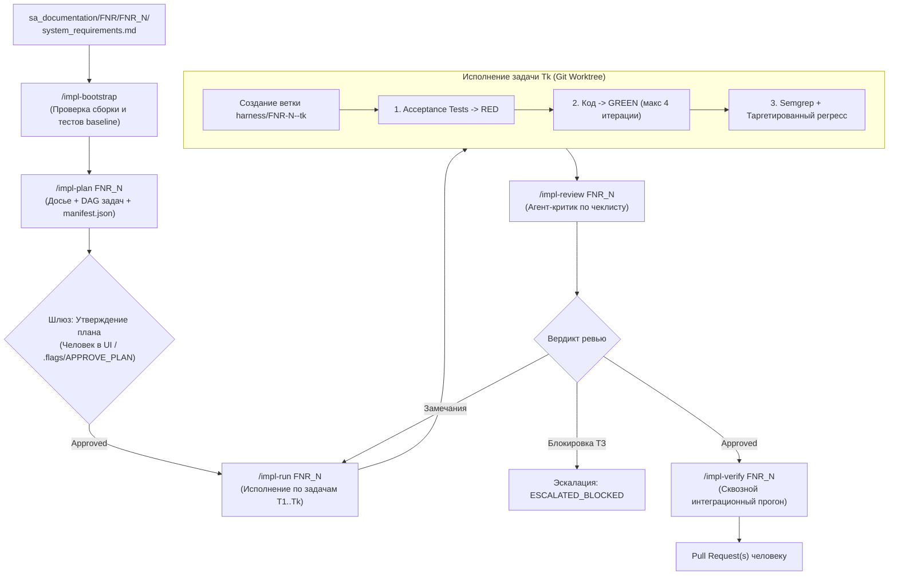
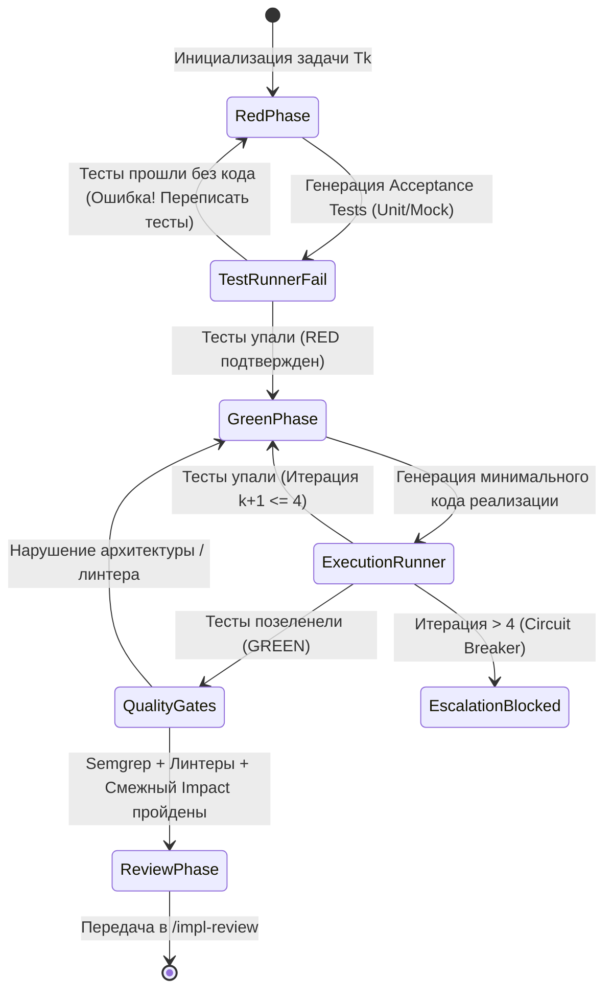

> Документ перенесён из локальной sa_documentation/ в репозиторий 03.11.2026. Статус и даты внутри — на момент написания, не факт что актуальны.

# AI Harness для SA-Helper: Архитектура, Процессы и Спецификация Реализации

> **Статус документа:** Базовая архитектурная спецификация (Design Document)  
> **Целевой модуль:** SA-Helper / Второй контур реализации (`Implementation Harness`)  
> **Назначение:** Автономная реализация системных требований из `FNR Pipeline` в работающий, протестированный и проверенный код.

---

## 1. Концепция и Миссия

Текущий контур **SA-Helper** завершает свою работу формированием формальных системных требований:
`sa_documentation/FNR/FNR_{N}/system_requirements.md` (BR / FR / NFR + Jira-декомпозиция + контракты API).

**AI Harness** — это второй контур системы (контур реализации). Его задача — взять утвержденные системные требования `FNR_{N}` и детерминированно превратить их в работающий код в репозиториях без галлюцинаций, нарушения архитектурных принципов и регресса смежного функционала.

### Базовые принципы:
1. **Нулевой допуск к галлюцинациям и строгая трассируемость (Traceability):** Каждое требование `FR-ID` связывается с конкретным unit/integration-тестом, коммитом и пунктом ревью.
2. **Human-in-the-Loop на контрольных шлюзах:** Агент автономен внутри задачи, но человек утверждает план реализации (`/impl-plan`) и принимает итоговый Pull Request. Никаких прямых неконтролируемых изменений в основных ветках.
3. **Изоляция исполнения через Git Worktree:** Работа ведется в отдельных изолированных деревьях; рабочее дерево разработчика или аналитика остается нетронутым.
4. **Независимость от тяжелой инфраструктуры:** Граф Neo4j и подсистема `indexer` являются **опциональным ускорителем**, а не блокером. Базовый контур работает универсально в любом окружении с помощью локального анализа («Досье области») и стандартных CLI-утилит.
5. **UI как пассивная витрина (Zero-Context Overhead):** Интерфейс отслеживания вынесен за пределы контекстного окна LLM. Агент оперирует только локальными файлами артефактов (`manifest.json` и flag-файлами).

### 1.1. Структура подпроекта Harness в репозитории
Harness является **автономным независимым подпроектом** и живет в отдельном каталоге `harness/` в корне репозитория (не смешиваясь с `indexer/`):

```
sa-helper/
├── .claude/commands/       # Команды агентов (/impl-*)
├── sa_documentation/       # Аналитические артефакты и FNR
├── indexer/                # [Опционально] Подпроект графа Neo4j
└── harness/                # [NEW] Автономный подпроект AI Harness
    ├── cli.py              # CLI-интерфейс (`sa harness ...`)
    ├── discovery.py        # Сканирование стека и генерация workspaces.yaml
    ├── runner.py           # Исполнение сборки/тестов в git worktree
    ├── semgrep_rules/      # Архитектурные правила линтинга
    └── ui/                 # Локальный легковесный Live Dashboard
        ├── ui_server.py    # SSE-сервер на стандартной библиотеке Python
        └── index.html      # Single-Page Kanban UI (Vanilla JS/CSS)
```

---

## 2. Общая схема контура реализации (Команды `/impl-*`)



### Спецификация команд:

| Команда | Вход | Выход | Назначение |
|:---|:---|:---|:---|
| `/impl-bootstrap [система]` | Кодовая база репозиториев | Протокол готовности среды | Проверяет, что проекты собираются и их существующие тесты проходят **до** начала правок. |
| `/impl-plan FNR_N` | `system_requirements.md` + `workspaces.yaml` | `harness/dossier.md`, `execution_plan.md`, `manifest.json`, карточки `tasks/T*.md` | Анализирует предметную область задачи, извлекает Golden Reference, строит DAG задач и контракты. Ожидает аппрува человека. |
| `/impl-run FNR_N [task_id]` | Задача `Tk` из плана | Код + тесты + коммит в ветку подзадачи | Автономный TDD-цикл в `git worktree`. При превышении 4 итераций останавливается с отчетом. |
| `/impl-review FNR_N [task_id]` | `git diff` подзадачи + требования | `harness/reviews/Tk_review.md` | Независимый агент-критик («адвокат дьявола») проверяет код на соответствие FR, безопасность и архитектурный стиль. |
| `/impl-verify FNR_N` | Все завершенные подзадачи эпика | Итоговый отчет верификации, PR | Сквозное контрактное и интеграционное тестирование взаимодействия затронутых сервисов. |

---

## 3. Универсальный контекстный движок (без зависимости от Neo4j)

Граф Neo4j переведен в категорию **акселератора**. Основной контур использует иерархический контекстный анализ:

```
┌────────────────────────────────────────────────────────┐
│ 1. Досье области (dossier.md) — фокус на задаче        │
│    - Доменный срез (Repo-Slice) через grep/AST         │
│    - Golden Reference (эталонный соседний модуль)      │
├────────────────────────────────────────────────────────┤
│ 2. Репозиторные конвенции                              │
│    - workspaces.yaml, CLAUDE.md, guidelines.md         │
├────────────────────────────────────────────────────────┤
│ 3. Встроенные языковые пресеты (Language Presets)      │
│    - Идиомы Go, Python, Java/Spring, TypeScript        │
├────────────────────────────────────────────────────────┤
│ 4. Опциональные ускорители                             │
│    - Repomix (--include по скоупу), Neo4j Graph DB     │
└────────────────────────────────────────────────────────┘
```

### 3.1. Алгоритм формирования «Досье области» (`harness/dossier.md`)
1. **Извлечение сигнатуры:** Из `system_requirements.md` извлекаются ключевые термины (например: сущности `Order`, `Payment`, статус `CANCELLED`).
2. **Локализация доменного среза (Repo-Slice):**
   - Поиск файлов через `ripgrep` по ключевым сущностям.
   - Ограничение скоупа: в контекст попадают только 4–7 файлов, непосредственно относящихся к домену (Контроллер, Сервис, DTO, Репозиторий/Entity, существующий файл тестов).
3. **Извлечение Golden Reference (Обучение стилю проекта):**
   - Поиск в этом же репозитории завершенного аналогичного сценария (например, соседний эндпоинт `UserDiscountController`).
   - Фиксация в `dossier.md` точных ссылок `файл:строка`:
     - Способ внедрения зависимостей (DI).
     - Формат валидации входящих DTO.
     - Механизм обработки и маппинга ошибок (Custom Exceptions, HTTP-коды).
     - Подход к логированию и транзакциям.
4. **Легковесный структурный Outline:** Если используется `repomix`, он запускается с флагом `--include` только для целевой директории и общих интерфейсов ядра (`core/`, `shared/`), без выгрузки всего монолита/репозитория.

### 3.2. Фолбэк-лестница для Impact Analysis (Защита от регресса без графа)
Чтобы при модификации модуля не ломался смежный функционал:
1. **Уровень 1 (Прямой импорт):** Поиск через `ripgrep` всех файлов, импортирующих изменяемый файл.
2. **Уровень 2 (Интерфейсы и DI-биндинги):** Поиск использований публичных сигнатур методов и реализаций интерфейсов (актуально для Spring, NestJS, Go-интерфейсов).
3. **Уровень 3 (Тесты по конвенции):** Автоматический запуск тестов найденных компонентов (например, `tests/**/test_<component>.*`).
4. **Уровень 4 (Финальная страховка):** Полный прогон сьюта репозитория в фоновом режиме перед финальным оформлением PR.

---

## 4. Межсистемные доработки и стек (Multi-Repo & Multi-Stack)

### 4.1. Реестр систем `workspaces.yaml`
В корне рабочего пространства или проекта размещается декларативный реестр:

```yaml
version: "1.0"
systems:
  order-service:
    path: "../order-service"
    stack: "go-1.22"
    build_cmd: "go build ./..."
    test_cmd: "go test -v -race ./..."
    lint_cmd: "golangci-lint run"
    guidelines: "docs/conventions.md"
    semgrep_rules: "harness/semgrep_rules/go"
    
  billing-service:
    path: "../billing-service"
    stack: "python-3.11-fastapi"
    build_cmd: "poetry check"
    test_cmd: "poetry run pytest"
    lint_cmd: "poetry run ruff check ."
    guidelines: "CONTRIBUTING.md"
    semgrep_rules: "harness/semgrep_rules/python"
```

#### 4.1.1. Автоматическая генерация `workspaces.yaml` (Auto-Discovery)
Пользователь **не должен составлять этот файл вручную**. Если при запуске `/impl-bootstrap` или `/impl-plan` файл отсутствует, агент генерирует его автоматически:
1. **Поиск репозиториев:** Сканирует workspace (`find . -maxdepth 2 -name .git`).
2. **Детекция стека:** Читает маркерные файлы (`pom.xml`, `go.mod`, `package.json`, `pyproject.toml`, `Cargo.toml`, `Makefile`).
3. **Извлечение команд:**
   - Для Node: берет команды из секций `scripts.test` и `scripts.lint` в `package.json`.
   - Для Java: проверяет наличие оберток `./mvnw` или `./gradlew`.
   - Для Python: проверяет `poetry`, `pipenv` или `pytest`.
   - Для Go: использует стандартные `go test ./...` и `golangci-lint run`.
4. **Поиск гайдлайнов:** Автоматически находит существующие `CLAUDE.md`, `CONTRIBUTING.md`, `docs/guidelines.md`.
5. **Human-in-the-Loop шлюз:** Агент выводит сводную таблицу обнаруженных систем в чат на быстрое подтверждение перед сохранением файла.

### 4.2. Принцип Contract-First для мультисервисных задач
Когда системные требования затрагивают 2+ сервиса:
1. **Задача T1 — всегда фиксация контракта:**
   - Изменение или создание спецификации взаимодействия (OpenAPI YAML, Protobuf `.proto`, AsyncAPI/JSON Schema для брокеров).
   - Запуск валидатора схемы (`spectral lint`, `buf lint`).
2. **Изоляция потребителей (Mocking):**
   - Для сервиса-потребителя (Consumer) Harness локально поднимает легковесный мок по спецификации (например, `npx prism mock api.yaml` на динамическом порту).
   - Потребитель реализуется и тестируется против замороженного контракта независимо от готовности сервиса-поставщика (Producer).
3. **Интеграционная верификация (`/impl-verify`):**
   - Запуск контрактных тестов на совместимость схем перед созданием PR.

---

## 5. Стандарты веток и изоляция через Git Worktree

Для обеспечения полной чистоты рабочей директории и предотвращения случайных коммитов в основные ветки:

1. **Именование веток:**
   - Ветка эпика (создается от `main` / `develop`):
     ```
     harness/FNR-<N>-<slug>
     ```
     *(Пример: `harness/FNR-12-cancel-order`)*
   - Ветки отдельных атомарных подзадач:
     ```
     harness/FNR-<N>-<slug>-t<k>
     ```
     *(Пример: `harness/FNR-12-cancel-order-t1`)*
2. **Работа в Git Worktree:**
   - Выполнение `/impl-run` происходит в изолированном каталоге:
     ```bash
     git worktree add .worktrees/FNR-12-t1 -b harness/FNR-12-cancel-order-t1
     ```
   - Разработчик или аналитик может параллельно продолжать работу в основном терминале/IDE — файлы в его редакторе не мелькают и не перезаписываются агентом.
   - По завершении или отмене подзадачи worktree удаляется: `git worktree remove`.

---

## 6. Структура артефактов в `sa_documentation/FNR/FNR_{N}/harness/`

Все рабочие материалы контура реализации строго изолированы внутри директории соответствующего FNR:

```
sa_documentation/
└── FNR/
    └── FNR_12/
        ├── task.md
        ├── concept.md
        ├── system_requirements.md       <-- Исходный канон требований
        └── harness/                     <-- [NEW] Изолированная директория Harness
            ├── dossier.md               # Досье области: релевантный код, цитаты, Golden Reference
            ├── execution_plan.md        # Человекочитаемый план работ и граф задач (DAG)
            ├── manifest.json            # Единый машиночитаемый state для агента и UI
            ├── tasks/                   # Карточки задач
            │   ├── T1_contract.md
            │   ├── T2_order_service.md
            │   └── T3_billing_consumer.md
            ├── logs/                    # Детальные логи выполнения компиляторов и тестов
            │   ├── T1_run.log
            │   └── T2_run.log
            ├── reviews/                 # Отчеты агента-критика (Code Review)
            │   ├── T1_review.md
            │   └── T2_review.md
            └── .flags/                  # Сигнальные флаг-файлы управления (Human-in-the-Loop)
                ├── APPROVE_PLAN
                ├── PAUSE
                └── APPROVE_T1
```

### 6.1. Машиночитаемый манифест `manifest.json`
Является единственным источником правды для UI и оркестратора:

```json
{
  "fnr_id": "FNR_12",
  "epic_branch": "harness/FNR-12-cancel-order",
  "status": "IN_PROGRESS",
  "created_at": "2026-10-14T12:00:00Z",
  "updated_at": "2026-10-14T12:15:30Z",
  "active_task_id": "T2",
  "circuit_breaker": {
    "max_iterations_per_task": 4,
    "current_iteration": 2
  },
  "tasks": [
    {
      "id": "T1",
      "title": "Спецификация OpenAPI для отмены заказа",
      "system": "order-service",
      "branch": "harness/FNR-12-cancel-order-t1",
      "status": "DONE",
      "depends_on": [],
      "acceptance_criteria": [
        {"id": "AC-1.1", "desc": "POST /api/v1/orders/{id}/cancel описан", "status": "PASSED"}
      ],
      "iteration_count": 1,
      "review_verdict": "APPROVED"
    },
    {
      "id": "T2",
      "title": "Реализация логики отмены в OrderService",
      "system": "order-service",
      "branch": "harness/FNR-12-cancel-order-t2",
      "status": "TDD_GREEN",
      "depends_on": ["T1"],
      "acceptance_criteria": [
        {"id": "AC-2.1", "desc": "Возврат 200 OK при статусе NEW", "status": "PASSED"},
        {"id": "AC-2.2", "desc": "Возврат 409 Conflict при статусе SHIPPED", "status": "IN_PROGRESS"}
      ],
      "iteration_count": 2,
      "review_verdict": "PENDING"
    }
  ]
}
```

---

## 7. Автономный TDD-цикл и Circuit Breaker

Исполнение подзадачи в `/impl-run` строится по строгому циклу:



### Защитные механизмы:
1. **Red Gate:** Тесты обязаны упасть на чистом коде. Если сгенерированный тест сразу проходит — он фиктивный (false-positive assertion) и бракуется.
2. **Circuit Breaker (Ограничитель попыток):**
   - На исправление ошибок тестов или компиляции дается **максимум 4 итерации**.
   - Если за 4 итерации код не позеленел: агент останавливает цикл, переводит задачу в статус `ESCALATED_BLOCKED`, формирует `logs/Tk_failure_report.md` и выставляет флаг остановки. Токены не сжигаются в бесконечных циклах.
3. **Характеризационные тесты для Legacy-модулей:**
   - Если у затронутого старого сервиса нет тестов, первой фазой агент генерирует Snapshot/Approval тесты, фиксирующие поведение As-Is («как сейчас работает»), и только после этого приступает к доработке.
4. **Semgrep Architecture Gates:**
   - Проверка запретов из `harness/semgrep_rules/`: отсутствие прямого SQL в контроллерах, обязательное использование DTO, запрет обхода сервисного слоя.

---

## 8. Локальный легковесный UI (Live Dashboard)

### 8.1. Принцип изоляции UI от LLM
- Агент **ничего не знает про браузер, сокеты или веб-сервер**. Он только читает и пишет файлы в файловую систему (`manifest.json` и файлы в каталоге `.flags/`).
- Это сохраняет контекстное окно LLM на 100% чистым для кода и требований.

### 8.2. Архитектура сервера (Zero Dependencies)
- Сервер представляет собой **один независимый Python-скрипт** (`harness/ui/ui_server.py`), использующий стандартную библиотеку Python (`http.server` с поддержкой SSE / Server-Sent Events).
- Запуск одной командой:
  ```bash
  python3 harness/ui/ui_server.py --fnr FNR_12
  ```
- **Решение проблемы CORS:** Сервер раздает статический HTML и эндпоинт данных с одного origin (`http://localhost:4040`), полностью исключая блокировки браузера.
- Потребление ресурсов: ~15 МБ RAM, 0% CPU в режиме ожидания.

### 8.3. Интерфейс (Dark/Glass Kanban Dashboard)
- **Колонки доски:**
  1. `Planned` (Сформированные задачи из плана)
  2. `Approved` (Одобренные к исполнению)
  3. `TDD Loop: RED / GREEN` (Активная разработка, индикатор итерации `k/4`)
  4. `Quality Gates & Review` (Проверка линтерами и агентом-критиком)
  5. `Done / PR Ready` (Успешно завершенные задачи)
  6. `Escalated (Blocked)` (Задачи, требующие вмешательства человека)
- **Интерактивные шлюзы управления через флаг-файлы:**
  - Кнопка **[Approve Plan]** в UI → сервер создает файл `harness/.flags/APPROVE_PLAN`.
  - Кнопка **[Pause]** → создает `harness/.flags/PAUSE`.
  - Кнопка **[Approve T1 Review]** → создает `harness/.flags/APPROVE_T1`.
  - Агент перед началом следующего шага делает дешевую проверку: `os.path.exists(...)`.

---

## 9. Процесс ревью (`/impl-review`) и приемка

Ревью выполняется отдельным изолированным агентом-критиком («адвокатом дьявола») с независимым системным промптом.

### Чеклист ревьюера (`Review Rubric`):
1. **Трассируемость требований:** Проверяется соответствие `FR-ID` из `system_requirements.md` → конкретный тест в кодовой базе → коммит в ветке.
2. **Безопасность (Security Baseline):** Проверка на инъекции, валидацию входных данных, безопасную обработку ошибок без утечки трассировок стека наружу.
3. **Обратная совместимость (Backward Compatibility):**
   - Отсутствие breaking changes в сигнатурах публичных методов.
   - Миграции БД только расширяющие (non-destructive DDL: `ADD COLUMN NULLABLE`).
4. **Соответствие Golden Reference:** Проверка чистоты стиля относительно эталона из `dossier.md`.

При наличии критических замечаний формируется `harness/reviews/Tk_review.md`, и задача возвращается в `/impl-run` с дельтой замечаний. При успехе — формируется Pull Request.

---

## 10. План реализации (Roadmap внедрения)

### Этап 1: Базовый каркас и Bootstrap (Неделя 1)
- Реализация команды `/impl-bootstrap`: проверка сборки и прогона тестов в целевом репозитории.
- Шаблон конфигурации `workspaces.yaml` с описанием команд сборки и линтеров.
- Создание базовой структуры каталога `sa_documentation/FNR/FNR_{N}/harness/`.

### Этап 2: Контекстный анализатор и планирование (Неделя 2)
- Реализация генератора `dossier.md`: доменный срез ключевых файлов + извлечение Golden Reference.
- Реализация команды `/impl-plan`: парсинг `system_requirements.md` и генерация `execution_plan.md`, `tasks/T*.md` и `manifest.json`.

### Этап 3: TDD-раннер и Git Worktree (Неделя 3)
- Реализация `/impl-run`:
  - Управление ветками `harness/FNR-...` через `git worktree`.
  - Исполнительный TDD-цикл (RED-тесты → GREEN-код).
  - Механизм Circuit Breaker (максимум 4 итерации с откатом).
- Интеграция проверок Semgrep.

### Этап 4: Локальный UI Dashboard (Неделя 4)
- Однофайловый Python HTTP/SSE сервер `ui_server.py`.
- Легковесный Single-Page Dashboard (Dark/Glass Kanban) с поддержкой флагов управления (`.flags/`).

### Этап 5: Агент-Ревьюер и Multi-Repo верификация (Неделя 5)
- Реализация команды `/impl-review` с чеклистом трассируемости `FR-ID → тест`.
- Поддержка Contract-First шага T1 для многосервисных задач и запуск `/impl-verify`.
