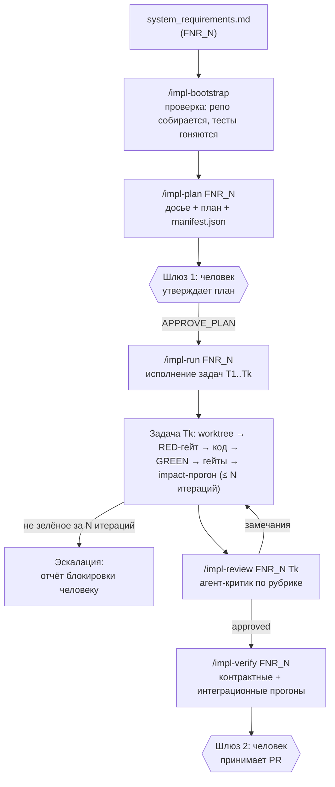

# AI Harness — контур реализации (финальная спецификация)

> **Статус:** базовый документ для реализации. **Реализовано:** пилот пройден end-to-end
> 2026-10-14…15 (bootstrap → plan → run → review → verify, задача T1 DONE/APPROVED;
> сквозной отчёт — в воркспейсе пилота: `sa_documentation/harness/pilot_report.md`).
> **Входная точка:** `sa_documentation/FNR/FNR_{N}/system_requirements.md` — выход существующего FNR-контура.
> **Выходная точка:** Pull Request(s) в репозитории затронутых систем + полный комплект артефактов в `FNR_{N}/harness/`.
> **Родственный документ:** `harness_by_v1.md` — первая проработка (архив, решения перенесены сюда).
> **Развитие (v3):** `handoff_pipeline_design.md` — автономный конвейер (демон, машина
> состояний, адресное управление, интерактивность); v2-гейты и изоляция не пересматриваются.

---

## 0. Суть в двух словах (бизнес-слой)

Сегодня sa-helper доводит работу до документа: системные требования написаны, согласованы — и дальше аналитик передаёт их разработчикам словами, встречами и Jira-тикетами.

**AI Harness — это второй контур: он превращает утверждённые системные требования в работающий код.** Аналитик запускает несколько команд, наблюдает за ходом работы на локальной доске задач (как Jira, только мгновенная и локальная), утверждает план, а в конце получает ветку с кодом, тестами и отчётом ревью — готовую для человеческого ревью и merge.

Что это меняет для аналитика:

- **Постановка задачи становится проверяемой.** Если требования неполные — harness спотыкается на этапе плана, а не после недели разработки. Ошибка аналитика обнаруживается за минуты, а не за спринт.
- **Смежный функционал защищён механически,** а не «на честном слове»: перед сдачей прогоняются тесты всех затронутых компонентов и полный набор тестов сервиса.
- **Человек остаётся хозяином процесса:** план утверждается до начала кодинга, каждая задача проходит ревью, итоговый PR принимает человек. Harness не сливает код в основные ветки сам.

Чем harness **не является**: это не автопилот, который «сам всё сделает». Это конвейер с двумя ручными шлюзами (план и PR) и автоматическими воротами качества между ними.

---

## 1. Принципы

1. **Требования = контракт.** Единственный источник правды для агента — `system_requirements.md`. Код, не покрытый требованиями, не пишется; требования, не покрытые кодом и тестами, — finding ревью.
2. **Автономность внутри задачи, человек на шлюзах.** Агент не спрашивает по мелочам. Шлюзы ровно два: утверждение плана и приёмка PR. Плюс аварийные: Pause / Abort из UI.
3. **UI — витрина, не канал.** Агент ничего не знает про UI: он читает и пишет файлы. Отдельный процесс рендерит состояние. Контекст модели не тратится на интерфейс ни байтом.
4. **Универсальность: тяжёлая инфраструктура — акселератор, не зависимость.** Граф Neo4j и `indexer` опциональны (complement-модель, как в `fnr-system-requirements`: «если MCP-инструменты недоступны — пропусти, продолжай по repomix»). Базовый контур работает на grep/поиске, repomix и стандартной библиотеке Python.
5. **Изоляция исполнения.** Работа только в `git worktree` и ветках `harness/*`. Прямые коммиты в `main`/`develop` запрещены технически (permissions/хуки), а не надеждой на аккуратность агента.
6. **Трассируемость как в документации, только для кода.** Каждая цепочка: `FR-ID → критерий приёмки → имя теста → коммит [FNR-N/Tk] → PR`. Проверяется ревьюером механически.
7. **Кроссплатформенность.** Инструменты harness (runner, scanner, UI-сервер, валидатор манифеста) — только стандартная библиотека Python на хосте, без venv и без pip-зависимостей. Сборка и тесты **целевых сервисов выполняются в Docker** (`docker run` / `docker compose`, команды задаются в `workspaces.yaml`) — тулчейны сервисов не ставятся на хост. Всё должно работать одинаково на macOS и Windows (Git Bash).

---

## 2. Общая схема



Оркестратор — **slash-команды** в `.claude/commands/` (та же архитектура, что у всего sa-helper). Python-инструменты (`harness/`) — тонкие утилиты: раннер тестов с парсингом отчётов, UI-сервер. Отдельного CLI-бинарника нет.

---

## 3. Требования к входному артефакту

Harness исполняет требования буквально, поэтому входной документ дополняется обязательными разделами (изменение в шаблоне `ideal_system_requirements.md`):

- **«Затронутые системы и контракты»** — таблица: система → репозиторий → тип изменения → точки интеграции (API/события/таблицы). Для одно-системной задачи — одна строка.
- **Критерии приёмки в поведенческой форме** на каждый FR: «при X метод возвращает Y» — именно из них генерируются тесты.
- У каждого FR — устойчивый `FR-ID` (уже в каноне), на него ссылается трассируемость.

Если разделы отсутствуют или критерии неверифицируемы — `/impl-plan` останавливается с перечнем пробелов и **не** начинает планирование. Это осознанный шлюз качества: потолок harness'а — качество требований.

---

## 4. Реестр систем `workspaces.yaml`

Декларативный реестр рабочего пространства — ответ на «как определить стек при доработке в нескольких системах»:

```yaml
version: "1.0"
systems:
  order-service:
    path: "../order-service"
    stack: "java-17-spring"            # детектируется по маркерным файлам
    build_cmd: "./mvnw -q compile"
    test_cmd: "./mvnw test"
    lint_cmd: "./mvnw checkstyle:check"
    guidelines: "docs/conventions.md"  # проектные принципы проектирования
    notes: "миграции только через Flyway"
```

**Auto-discovery:** файл не составляется вручную. При отсутствии `/impl-bootstrap` генерирует его: сканирует workspace (`find . -maxdepth 2 -name .git`), детектирует стек по маркерным файлам (`pom.xml`, `go.mod`, `package.json`, `pyproject.toml`, `*.csproj`, `composer.json`), извлекает команды (`scripts.test` из package.json, `./mvnw`/`./gradlew`, `poetry`/`pytest`, `go test ./...`), находит гайдлайны (`CLAUDE.md`, `CONTRIBUTING.md`, `docs/guidelines.md`). Сводная таблица выводится человеку на подтверждение до записи файла. Стек из `workspaces.yaml` — приоритетнее эвристик агента.

---

## 5. Контекстный движок: «Досье области»

Замена графу. Собирается `/impl-plan` и сохраняется как артефакт (не эфемерный промпт!) — ревьюер обязан иметь возможность проверить, на что опирался кодер.

Слои, от обязательных к опциональным:

| # | Слой | Содержимое |
|---|------|-----------|
| 1 | **Структурный Outline** (макро) | Сигнатуры классов/интерфейсов/эндпоинтов репозитория без тел методов — каркас сервиса за ~15–30k токенов (ctags/tree-sitter или скоупед repomix) |
| 2 | **Доменный срез** (микро) | 4–7 файлов затронутой области, найденных по доменным терминам из требований (ripgrep): контроллер, сервис, DTO, репозиторий, существующий тест |
| 3 | **Golden Reference** | 1–3 завершённых аналога по структурной сигнатуре задачи («соседний POST-эндпоинт с сохранением сущности»). В досье — цитаты `файл:строка`: стиль DI, валидация DTO, обработка ошибок, логирование, транзакции |
| 4 | **Репо-конвенции** | Файл из `workspaces.yaml` + `CLAUDE.md` репозитория |
| 5 | **Языковой пресет** | `harness/presets/<язык>.md` — канонические идиомы стека (Python: type hints/pytest/ruff; Go: table-driven tests, `%w`-wrapping; Java: JUnit5+AssertJ, Mockito; TS: strict mode, Vitest). Офлайн, без сети |
| 6 | **Ускорители** (опционально) | repomix `--include` по скоупу; MCP-инструменты графа (`graph_impact`, `graph_call_chain`), если подняты; Context7 — для идиом фреймворка, если доступен |

Golden Reference подкладывается кодеру с жёсткой инструкцией: «пиши строго в стиле эталона — те же подходы к DI, валидации, логированию, исключениям». Соответствие эталону — пункт ревью.

---

## 6. Контракты команд

Канон sa-helper: каждая команда описана контрактом **вход → выход → дальше**, с гейтами и поведением при сбое.

### 6.1 `/impl-bootstrap [система]`

| | |
|---|---|
| **Вход** | Путь к репозиторию (или `workspaces.yaml`) |
| **Выход** | `harness/bootstrap_report.md`: собралось/не собралось, сколько тестов зелёных/красных **до** каких-либо правок, сгенерированный/обновлённый `workspaces.yaml` |
| **Дальше** | `/impl-plan` |
| **Сбой** | Репо не собирается или baseline-тесты красные → **стоп**, harness не приступает к доработкам. Отчёт с ошибками — человеку |

Правило: агент не имеет права писать код в репозитории, который не может собрать и протестировать.

### 6.2 `/impl-plan <path_to_system_requirements>`

| | |
|---|---|
| **Вход** | `system_requirements.md` + `task.md` того же FNR + `workspaces.yaml` |
| **Выход** | `harness/dossier.md` (по системе), `harness/execution_plan.md` (DAG задач, человекочитаемый), `harness/tasks/T*.md` (карточки), `harness/manifest.json` (машиночитаемое состояние) |
| **Гейты** | Входные разделы требований полны (раздел 3); для мульти-систем — первая задача фиксирует контракт; для легаси без тестов — первая задача характеризационная |
| **Дальше** | Человек читает план, утверждает через UI (`APPROVE_PLAN`) или правки в чате → перегенерация |
| **Сбой** | Пробелы в требованиях → отчёт о пробелах, планирование не начинается |

Карточка задачи (канон «вход→выход→дальше» в миниатюре): цель со ссылкой на `FR-ID`, критерии приёмки (из них родятся тесты), затронутые файлы/компоненты, Golden Reference ссылки, тип (contract/feature/refactor/characterization), `depends_on`, оценка радиуса (импортёры).

### 6.3 `/impl-run FNR_N [task_id]`

| | |
|---|---|
| **Вход** | Аппрувнутый план, карточка задачи, досье |
| **Выход** | Коммит(ы) `[FNR-N/Tk]` в ветке `harness/FNR-<N>-<slug>-t<k>`, обновлённый `manifest.json`, логи в `harness/logs/Tk_run.log` |
| **Гейты** | См. раздел 7 (RED-гейт, circuit breaker, quality gates, impact-прогон) |
| **Дальше** | `/impl-review` по завершённой задаче |
| **Сбой** | Исчерпан бюджет итераций → статус `ESCALATED_BLOCKED`, `harness/logs/Tk_failure_report.md`: что делалось, какие ошибки, гипотезы, что нужно человеку |

Проверяет флаги (`PAUSE`, `ABORT`) на границе каждой итерации и между задачами.

### 6.4 `/impl-review FNR_N [task_id]`

| | |
|---|---|
| **Вход** | `git diff` задачи + `system_requirements.md` + `dossier.md` + рубрика (раздел 11) |
| **Выход** | `harness/reviews/Tk_review.md`: вердикт (`APPROVED` / `CHANGES_REQUESTED` / `BLOCKED`) + находки по пунктам рубрики со ссылками на строки |
| **Дальше** | `APPROVED` → следующая задача или `/impl-verify`; `CHANGES_REQUESTED` → возврат в `/impl-run` с дельтой замечаний; `BLOCKED` → эскалация |

Ревьюер — отдельный агент с независимым контекстом (кодер и ревьюер не делят память диалога). Человеческое ревью не заменяется — дешевится.

### 6.5 `/impl-verify FNR_N`

| | |
|---|---|
| **Вход** | Все задачи в `DONE`/`APPROVED`, контракты из задачи T1 |
| **Выход** | `harness/verification_report.md`: контрактные тесты, сквозной сценарий из требований, финальные полные прогоны всех затронутых репозиториев; сформированные PR со связями |
| **Дальше** | Человек: ревью и merge PR |

### UI (не команда агента)

`python3 harness/ui/ui_server.py --fnr FNR_N` — запускается человеком отдельно. Агент может лишь *предложить* команду запуска.

---

## 7. Исполнительный цикл задачи (`/impl-run`)

Порядок внутри одной задачи, в worktree:

1. **RED-гейт.** Из критериев приёмки генерируются тесты (unit + моки). Прогон: тесты **обязаны упасть**. Если прошли на нереализованном коде — тесты фиктивные, бракуются и переписываются. Тест именуется по критерию: `test_ac_2_1_returns_200_for_new_order` — это звено трассируемости.
2. **GREEN-петля.** Кодеру подаются: карточка, падающие тесты, досье (Golden Reference + пресет + конвенции). Минимальная реализация до зелёного. Промежуточные ошибки — структурированно (раннер отдаёт парсенный вывод: файл, строка, тип ошибки, а не простыню логов).
3. **Circuit breaker.** Бюджет итераций самопомощи — **4** (настраивается в `manifest.circuit_breaker`). Исчерпан → `ESCALATED_BLOCKED` + отчёт блокировки. Токены не сжигаются в бесконечной петле.
4. **Quality gates** (механические, не «отчёт агента»): линтеры, `semgrep`-правила проекта (готовые наборы лежат в `indexer/semgrep_rules/` — это простые YAML-файлы, граф не нужен; проектные архитектурные правила добавляются рядом), дельта покрытия по изменённым строкам ≥ 80%.
5. **Impact-прогон (лестница, без графа):**
   - импортёры изменённых файлов (ripgrep) → их тесты;
   - использования публичных сигнатур / реализаций интерфейсов;
   - тесты смежных компонентов по конвенции нейминга;
   - **полный прогон сьюта репозитория перед PR** — обязательная страховка.
   - Если граф доступен (опция) — `graph_impact` сужает набор на шагах 1–3; лестница не меняется.
6. **Диф-совместимость:** не изменены сигнатуры публичных методов, не удалены обязательные поля API/событий, DDL только расширительный (`ADD COLUMN NULLABLE`).

**Легаси без тестов:** если затронутый модуль не покрыт, первая задача по нему — характеризационная (фиксируем поведение As-Is snapshot-тестами), и только потом изменение.

**Legacy-граф:** перед финальным impact-прогоном граф (если используется) переиндексируется — impact по данным до правок агента недопустим.

---

## 8. Мульти-системность: contract-first

Когда требование затрагивает 2+ систем:

1. **Фаза контракта — всегда задача T1.** OpenAPI / protobuf / AsyncAPI / JSON Schema + валидатор (`spectral`, `buf` — опционально). Контракт замораживается коммитом.
2. **Producer → Consumer с зависимостью.** В `manifest.json`: `phase: contract|producer|consumer`, `depends_on`. Consumer реализуется против контракта: если инструмент мока доступен (`prism`) — мок по спецификации; если нет — фикстуры, сгенерированные из схемы. Зависимость от готовности producer'а отсутствует.
3. **Ветки синхронны:** одно имя `harness/FNR-<N>-<slug>(-t<k>)` во всех затронутых репозиториях — корреляция изменений между системами по имени ветки.
4. **`/impl-verify`** гоняет контрактные тесты на совместимость схем и сквозной сценарий из требований через все системы.

---

## 9. Ветки, worktree, enforcement

- **Ветки:** эпик `harness/FNR-<N>-<slug>`, подзадачи `harness/FNR-<N>-<slug>-t<k>` (от эпика). Позиционируется «harness» в начале имени — фильтруемо в любом GUI.
- **Коммиты:** `[FNR-12/T2] feat: add cancel endpoint in OrderService` — задача видна в git-истории.
- **Worktree:** `git worktree add .worktrees/FNR-12-t2 -b harness/FNR-12-cancel-order-t2`; по завершении/отмене — `git worktree remove`. Рабочее дерево аналитика не затрагивается; параллельные задачи не мешают друг другу.
- **Enforcement (технический, не дисциплинарный):**
  - permission-запрет на `git push` в `main`/`develop` и на коммиты вне `harness/*` (хук `pre-commit`/`pre-push` в worktree);
  - merge — только через PR, принимает человек.
- Все операции git — через портируемый синтаксис (macOS + Windows Git Bash).

---

## 10. Артефакты и состояние

```
sa_documentation/FNR/FNR_12/
├── task.md, concept.md, system_requirements.md   # как сейчас (вход)
└── harness/
    ├── bootstrap_report.md
    ├── dossier.md                 # досье области: outline, срез, golden refs, пресет, конвенции
    ├── execution_plan.md          # DAG задач, человекочитаемый
    ├── manifest.json              # единое состояние для агента и UI
    ├── tasks/T1_contract.md ...   # карточки задач
    ├── logs/T2_run.log            # сырые прогоны
    ├── logs/T2_failure_report.md  # отчёты блокировок
    ├── reviews/T2_review.md       # вердикты ревьюера
    ├── verification_report.md
    └── .flags/                    # транспорт управления: APPROVE_PLAN, PAUSE, APPROVE_T2 ...
```

`manifest.json` — единственный источник правды для оркестратора и UI. Схема (ключевое):

```json
{
  "fnr_id": "FNR_12",
  "epic_branch": "harness/FNR-12-cancel-order",
  "status": "IN_PROGRESS",
  "circuit_breaker": { "max_iterations_per_task": 4 },
  "tasks": [
    {
      "id": "T2",
      "title": "Отмена заказа в OrderService",
      "system": "order-service",
      "phase": "producer",
      "requirement_ids": ["FR-3.1", "FR-3.2"],
      "depends_on": ["T1"],
      "branch": "harness/FNR-12-cancel-order-t2",
      "status": "TDD_GREEN",
      "iteration_count": 2,
      "acceptance_criteria": [
        { "id": "AC-2.1", "desc": "200 OK при статусе NEW", "status": "PASSED",
          "test": "OrderServiceTest.test_ac_2_1_returns_200_for_new_order" }
      ],
      "gates": { "lint": "PASSED", "coverage": "PASSED", "impact": "PASSED" },
      "review_verdict": "PENDING"
    }
  ]
}
```

Статусы задачи (канонический enum): `PLANNED → APPROVED → TDD_RED → TDD_GREEN → GATES → AGENT_REVIEW → DONE`; терминальные: `ESCALATED_BLOCKED`, `ABORTED`. `PAUSED` — оверлей по флагу. Поле `test` в критерии — звено трассируемости `FR-ID → AC → тест`.

---

## 11. Рубрика ревью

| # | Пункт | Проверка |
|---|-------|----------|
| 1 | **Полнота требований** | Каждый `FR-ID` затронутых задач закрыт кодом и тестом; тесты соответствуют критериям приёмки |
| 2 | **Безопасность** | Инъекции, валидация входных данных, проверка прав (IDOR), секреты не в логах, ошибки без утечки стектрейсов наружу |
| 3 | **NFR** | Таймауты на внешних вызовах, транзакции, идемпотентность обработчиков, обработка ошибок по конвенции репо |
| 4 | **Обратная совместимость** | Сигнатуры публичных методов, поля API/событий, расширительные миграции |
| 5 | **Стиль проекта** | Соответствие Golden Reference из `dossier.md` и репо-конвенциям (ссылки на конкретные строки диффа) |
| 6 | **Покрытие** | Diff-coverage изменённых строк ≥ 80% |

Вердикты: `APPROVED` / `CHANGES_REQUESTED` (возврат в run с дельтой) / `BLOCKED` (эскалация). Находки — всегда с `файл:строка`, в духе «нулевого допуска к галлюцинациям» из `validate-doc`.

---

## 12. UI: Live Dashboard

**Принцип:** однонаправленный поток. Агент пишет `manifest.json` и читает `.flags/`; сервер читает `manifest.json` и пишет `.flags/`; браузер только смотрит. Модель не рендерит, не серверит и не описывает UI.

- **Сервер:** один скрипт `harness/ui/ui_server.py`, **только стандартная библиотека** (`http.server` + SSE). Ноль зависимостей → одинаково работает на macOS и Windows. Статика и данные с одного origin (порт, например, 4040) — без CORS.
- **Клиент:** один HTML-файл, Vanilla JS/CSS, тёмная тема. Обновление живьём по SSE.
- **Канбан:** `Planned → Approved → TDD Loop (RED/GREEN, итерация k/4) → Gates & Review → Done/PR → Escalated`.
- **Видно в реальном времени:** текущая задача, какой критерий красный, итерация k/4, последний парсенный текст ошибки (не простыня лога).
- **Шлюзы через флаг-файлы:** кнопка в UI → сервер создаёт `harness/.flags/APPROVE_PLAN` / `PAUSE` / `APPROVE_T2`. Агент проверяет наличие файла на границах итераций и задач — цена: одно `exists()`. `PAUSE` снимается удалением файла или кнопкой Resume.

---

## 13. Подпроект `harness/` в репозитории

Инструменты, не оркестратор (оркестрация — в slash-командах):

```
harness/
├── runner.py          # запуск build/test/lint, парсинг JUnit XML/pytest-вывода → структурированные ошибки
├── ui/
│   ├── ui_server.py   # SSE-сервер на stdlib
│   └── index.html     # канбан
├── presets/           # языковые пресеты: python.md, go.md, java-kotlin.md, typescript.md, csharp.md, php.md
└── semgrep_rules/     # архитектурные правила проектов (базовые — копия/ссылка на indexer/semgrep_rules)
```

Зависимости подпроекта: Python 3.10+, git; для исполнения команд сервисов — Docker. Не требуется: Neo4j, venv, npm, локальные тулчейны сервисов (JDK, Maven, pip-окружения).

---

## 14. Границы ответственности (что harness НЕ делает)

- Не сливает код: merge — только человек через PR.
- Не деплоит и не трогает CI/CD-конфигурацию без явной задачи в требованиях.
- Не работает вне веток `harness/*` и вне worktree.
- Не меняет требования сам: несоответствие между кодом и требованиями — finding ревью или эскалация, а не тихая «доработка за аналитика».
- Не стартует, пока baseline репозитория не зелёный (`/impl-bootstrap`).

---

## 15. Порядок внедрения и метрики

Вместо календарных оценок — этапы с критериями готовности. Пилот: **один репозиторий с хорошим покрытием тестами**, одно-системный FNR.

| Этап | Содержимое | Готово, когда |
|------|-----------|---------------|
| 1. Bootstrap | `/impl-bootstrap`, auto-discovery `workspaces.yaml` | На пилотном репо baseline зелёный без ручных правок |
| 2. План | `/impl-plan`: досье + DAG + manifest | Человек утверждает план без существенных правок на пробном FNR |
| 3. Run | `/impl-run`: worktree, RED-гейт, circuit breaker, гейты, impact-лестница | Пробная задача доходит до зелёного без эскалации |
| 4. Review + Verify | `/impl-review`, `/impl-verify` | Находки ревью подтверждаются/опровергаются по существу, PR формируется |
| 5. UI | `ui_server.py` + канбан + флаги | План аппрувится и Pause работает из браузера |
| 6. Мульти-системность | Contract-first фазы, синхронные ветки | Пробный двух-сервисный FNR проходит verify |

**Метрики пилота** (собираются из `manifest.json` — UI и так их уже имеет):

- доля задач, завершённых без эскалации;
- среднее число итераций на задачу (близость к 1 — качество планов и досье);
- находки ревью по категориям рубрики (куда дрейфует качество);
- регресс-побеги: проблемы, найденные человеком *после* агентского ревью;
- объём правок человека в PR (строки до merge).

Эти числа — критерий расширения пилота на мульти-системные доработки и на другие репозитории. Рост итераций и эскалаций на новом репо — сигнал сначала улучшить `guidelines` и досье, а не винить исполнителя.

---

## 16. Открытые вопросы (зафиксировать до этапа 3)

1. Хранение `workspaces.yaml`: в sa-helper (по воркспейсу) или в каждом целевом репо?
2. Параллельное исполнение независимых задач (`depends_on`-острова) — последовательный запуск v1, параллельный через несколько worktree — v2.
3. Инкрементальная переиндексация графа, если акселератор используется.
4. Формат связи с Jira: создавать тикеты из `manifest.json` или ограничиться PR-ссылками на FNR.

---

## 17. Уточнения реализации (зафиксированы при планировании пилота FNR_8 / Концепт F)

Решения, конкретизирующие спецификацию для пилота; не отменяют канон выше.

1. **Сборка и тесты сервисов — в Docker.** Команды `build_cmd`/`test_cmd`/`lint_cmd` в `workspaces.yaml` выполняются через `docker run`/`docker compose` (например, `docker run --rm -v "$PWD":/ws -w /ws maven:... mvn test`) — тулчейны не ставятся на хост. JUnit-отчёты (surefire, pytest `--junitxml`) пишутся в примонтированный каталог репозитория и парсятся `runner.py` на хосте. При таймауте runner гасит процесс-клиент Docker; одноразовые контейнеры (`--rm`) при эскалации подчищаются вручную (`docker ps`).
2. **Coverage-гейт — опциональный.** Дельта покрытия по изменённым строкам (§7, п. 4) проверяется только если в репозитории доступен инструмент покрытия (pytest-cov/coverage, jacoco). В stdlib Python покрытия нет — отсутствие инструмента означает пропуск гейта с пометкой в отчёте, а не блокировку.
3. **Worktree и чистота репозитория.** Деревья `.worktrees/` создаются внутри целевого репозитория, но скрываются через `.git/info/exclude` (локальный, не отслеживаемый файл) — отслеживаемый `.gitignore` чужих репозиториев не правится. Поискам агента (ripgrep, глобы) запрещено рекурсировать в `.worktrees/`.
4. **Опциональные инструменты — деградация, не ошибка.** `semgrep`, `spectral`/`prism`, `pytest-cov`, JUnit XML — если инструмент недоступен (`shutil.which`), соответствующий гейт пропускается с пометкой в manifest/отчёте. Канон complement-модели `fnr-system-requirements`.
5. **Отчёт bootstrap.** `/impl-bootstrap <система> [FNR_N]`: с указанием FNR отчёт пишется в `FNR_N/harness/bootstrap_report_<system>.md`, без — в `sa_documentation/harness_reports/<system>/bootstrap_report.md` (bootstrap может выполняться до выбора FNR; суффикс системы — для мульти-системных FNR).
6. **Идентификация требований.** Канон FR-ID в СТ: строка `| FR-ID | FR-<номер задачи> |` в метаданных каждой задачи (например, `#### 4.2.1` → `FR-4.2.1`); критерии приёмки получают префикс `AC-<номер задачи>.<k>`. Для документов, написанных до введения канона, действует маппинг: `FR-ID := FR-<номер задачи>` (§6.2, раздел 3) — карта соответствия фиксируется в `dossier.md` (ID map).
7. **Системы «только данные» (data-only).** Репозиторий без исполняемого кода (например, SSDT-проект базы данных) помечается в `workspaces.yaml` стеком `*-data-only` с пустыми `build_cmd`/`test_cmd`. Гейты сборки/тестов для его задач получают статус `SKIPPED (data-only)`; контроль изменений — ревью DDL (расширительные миграции, §7 п. 6) и опциональный деплой dacpac в контейнер БД вне базового контура.
